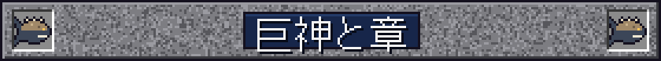
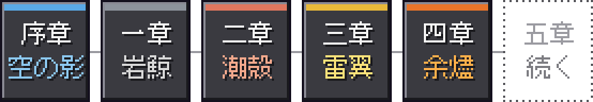
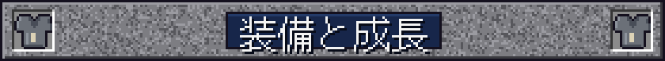
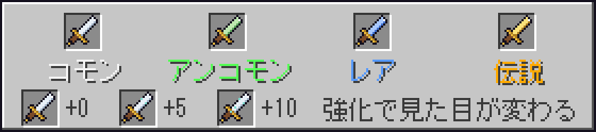
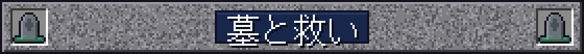
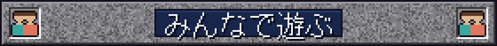
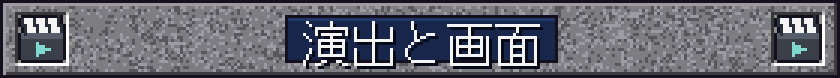
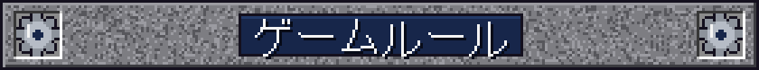
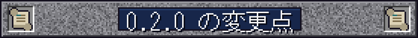

  

  
  
  
  

  <em>空を、何かが通った。</em> 
  <em>山より大きな影が、雲の上を、音もなく。</em>

  <a href="#titans"><b>巨神と章</b></a> &nbsp;|&nbsp;
  <a href="#gear"><b>装備</b></a> &nbsp;|&nbsp;
  <a href="#grave"><b>墓</b></a> &nbsp;|&nbsp;
  <a href="#party"><b>パーティ</b></a> &nbsp;|&nbsp;
  <a href="#start"><b>はじめかた</b></a> &nbsp;|&nbsp;
  <a href="#keys"><b>操作</b></a> &nbsp;|&nbsp;
  <a href="#rules"><b>ゲームルール</b></a> &nbsp;|&nbsp;
  <a href="#changes"><b>0.2.0</b></a> &nbsp;|&nbsp;
  <a href="#issues"><b>既知の問題</b></a>

**天と淵のあいだ** は、Minecraft Java 版 1.21.1（NeoForge）向けの RPG mod です。

目を開けると、そこは見知らぬ野営地。人が去った跡と、一冊の古い帳面だけがあります。
遠くの煙、ときどき響く鐘、道の脇の巨大すぎる足跡、夜に地面を伝う足音、空を横切る影。
やがてあなたは、空を泳ぎ、海を歩き、嵐をまとい、地の底を泳ぐ **四体の巨神** に出会い、その背に乗り込みます。

建築も、採掘も、いつものマイクラのまま。そこに、怖さと冒険と、少しずつ解けていく謎が重なります。

> **ベータ版（v0.2.2）** です。序章と、巨神 1 体ごとの四つの章を越えて「天の鍵」がそろうところまで遊べます。物語はその先へ続きますが、ベータ版はここまでです。

<h2 align="center"></h2>

物語は **巨神 1 体につき 1 章** で進みます。章が開くと題字の札が出て、拠点の近くにその章の小さな仕掛けが現れ、巨神が姿を見せる前には予兆が起きます。

<table align="center">
  <tr>
    <td align="center"> <b>一章　岩鯨</b>　雲の上を泳ぐ、岩をまとった鯨</td>
    <td align="center"> <b>二章　潮殻</b>　海を歩く、塔を載せた段々の島</td>
  </tr>
  <tr>
    <td align="center"> <b>三章　雷翼</b>　嵐をまとう、雷雲の大鷲</td>
    <td align="center"> <b>四章　余燼</b>　地を泳ぐ、皮が岩になる火蜥蜴</td>
  </tr>
</table>

<table>
  <tr>
    <td width="56" align="center"></td>
    <td><b>巨神の背はダンジョン。</b> 鎖、潮門、昇り風、熱い口と、乗り方も巨神ごとに違います。背中には三つの試練と、体の奥で待つ守護者。毎回少しずつ形が変わります。乗れるときは、乗り込み口が遠くからほのかに光ります。巨神に乗って移動できるのは、いまは岩鯨と潮殻です。</td>
  </tr>
  <tr>
    <td align="center"></td>
    <td><b>背中の進みはパーティごと。</b> 開けた扉や越えた守護者は、同じ背中にいる別のパーティとは混ざりません。守護者を越えた巨神は、深い眠りに落ちて元の世界から去り、戦った人を足もとへそっと降ろします（すでに背中にいるほかのパーティは、そのまま最後まで進められます）。巨神はしばらくすると目を覚まします。</td>
  </tr>
  <tr>
    <td align="center"></td>
    <td><b>低ポリとドット絵。</b> 巨神も敵も装備も、斜めの面を組んだ立体（ローポリ）に、マイクラと同じ手ざわりのドット絵を貼っています。巨神は距離で作りを変えるので、遠くからでも形が分かります。</td>
  </tr>
  <tr>
    <td align="center"></td>
    <td><b>碑と伝承の書。</b> 看板のかわりに、石の碑を読みます。見たもの、読んだ碑文、聞いた話が <b>伝承の書</b> に記されます。鐘の宿りの語り部や、空を追う旅人イサナとの会話、メインクエスト、サブクエストと日替わり・週替わりの依頼もあります。</td>
  </tr>
</table>

<ul>
  <li><b>倒れても、戻れる。</b> 戦いの中で倒れたら、20 秒たつと扉から戻れます（一つの戦いで 3 回まで）。戻った人は 3 秒のあいだ傷を受けません。</li>
  <li><b>床で読める予告。</b> 敵の技は床に範囲が出てから来ます。橙は傷の出る所、青白い破線は安全な筋、灰色は押すだけです。</li>
  <li><b>備えの三灯。</b> 乗り込み口で、身・刃・糧の備えを三つの灯で見せます。足りなくても、確かめれば乗れます。</li>
  <li><b>停まっている時間。</b> 巨神は止まってから約 20 分のあいだ乗れて、残り 2 分と 30 秒に知らせが出ます。</li>
</ul>

<h2 align="center"></h2>

<table>
  <tr>
    <td width="56" align="center"></td>
    <td><b>巨神ごとの武器と防具。</b> 素材も巨神ごと（鱗片・殻片・羽軸・燠石）。ランダムな特性、必要レベル、共鳴の炉での強化と再鍛造があり、説明にはその巨神の物語が一行ずつ添えられています。階級（コモン・アンコモン・レア・伝説）で形が変わり、強化 <b>+5</b>・<b>+10</b> で絵と光る画素が変わります。</td>
  </tr>
  <tr>
    <td align="center"></td>
    <td><b>装飾品。</b> 護符、護石などは、持ち物の画面の「装飾」の専用枠に付けたときだけ効きます。<b>H キー</b> で護符を使えます。体に付けた姿も見えます。</td>
  </tr>
  <tr>
    <td align="center"></td>
    <td><b>周回と天井。</b> 欲しい装備は周回で狙います。運が悪くても、いつかは必ず手に入る「天井」つきです。</td>
  </tr>
</table>

- **レベルとステータス**：力・敏捷・精神・耐久を自分で振り分け。物語の進みでレベルの上限が決まります（15 → 21 → 27 → 33 → 40）。
- **技**：剣士と弓使いの技を組み合わせ、4 つの枠（R・G・V・Z）にセットしてキーひとつで放ちます。

<h2 align="center"></h2>

<table>
  <tr>
    <td width="56" align="center"></td>
    <td>地上で倒れると、苔むした積み石の <b>墓</b> が立ち、持ち物の残りと経験値がそこに入ります。装備中の防具や大事な品は持ったまま復活します。墓は時間で消えず、開けられるのは持ち主だけです。場所は <b>B キー</b> の控え帳で分かります。</td>
  </tr>
  <tr>
    <td align="center"></td>
    <td>取りに行けないときは、鐘の宿りの <b>語り部</b> に頼めます。選んだ墓の中身の半分が戻ります。</td>
  </tr>
</table>

<h2 align="center"></h2>

<table>
  <tr>
    <td width="56" align="center"></td>
    <td><b>パーティは 6 人まで。</b> 近くの仲間と経験値を分け合えます（<b>O キー</b>）。試練は人数に合わせて敵が増え、報酬は一人ずつ別々に抽選されるので、取り合いになりません。一人で遊ぶ人は、一人のパーティとして進みます。</td>
  </tr>
</table>

<h2 align="center"></h2>

<table>
  <tr>
    <td width="56" align="center"></td>
    <td><b>シネマティック。</b> 始まりの暗転と題字、巨神が眠る場面、章の節目などは、短い場面として流れます。見たくない場面は、いつでも <b>スキップ</b> できます。驚かせる演出には頼りません。「いつもと何かが違う」怖さです。</td>
  </tr>
  <tr>
    <td align="center"></td>
    <td><b>目的の帯。</b> 今やることが、画面の「目的の帯」に一行で出ます。語りは画面下の字幕、レベルアップは画面中央の演出、獲得は右上の札。チャット欄はほとんど埋まりません。流れた知らせは <b>N キー</b> の「知らせの記録」で読み返せます。</td>
  </tr>
  <tr>
    <td align="center"></td>
    <td><b>進捗（実績）。</b> 巨神の背の試練、装備、章の節目など、遊びの区切りに進捗が付きます。</td>
  </tr>
  <tr>
    <td align="center"></td>
    <td><b>字はバニラのフォント。</b> mod の画面も、マイクラ標準のフォントでそろえています。</td>
  </tr>
</table>

<h2 align="center"></h2>

### 必要なもの

| もの | バージョン |
| --- | --- |
| Minecraft Java 版 | 1.21.1 |
| NeoForge | 1.21.1 |
| GeckoLib | NeoForge 1.21.1 用 |
| Java | 21 |

<table>
  <tr>
    <td width="56" align="center"></td>
    <td><code>skyabyss-0.2.2.jar</code> と GeckoLib の jar を、どちらも <code>mods</code> フォルダに入れて起動します（サーバーなら、サーバーの <code>mods</code> にも同じものを）。ソースから作るときは <code>./gradlew build</code>（<code>build/libs/</code> にできます）。</td>
  </tr>
</table>

- **新しいワールド** で始めてください。一人でも、仲間と（6 人まで）でも遊べます。
- 難易度は **ピースフル以外** に（ピースフルでは巨神の試練が眠ったままです）。
- 最初の起動のあと、巨神の背中の建物は裏で少しずつ建ちます。数分は動きが少し重いことがあります。
- 最初に世界へ入ると、暗い画面から始まります。少し待ってください。

### 最初の道のり

<table>
  <tr>
    <td width="72"></td>
    <td><b>野営地で目覚める。</b> 暗い画面から、題字とともに視界が戻ります。人が去った跡の野営地です。</td>
  </tr>
  <tr>
    <td></td>
    <td><b>古い帳面を拾う。</b> 帳面が <b>伝承の書</b> の最初のページになります。次にやることは「目的の帯」が教えてくれます。</td>
  </tr>
  <tr>
    <td></td>
    <td><b>煙と鐘の音を追う。</b> 遠くの細い煙の柱。道には積み石が並び、着いた先が <b>鐘の宿り</b> です。</td>
  </tr>
  <tr>
    <td></td>
    <td><b>足跡を見つける。</b> 道の脇に、人の足の形をした巨大なくぼみが並んでいます。</td>
  </tr>
  <tr>
    <td></td>
    <td><b>語り部に会う。</b> 鐘の宿りで話しかけると、物語が動き出します。</td>
  </tr>
  <tr>
    <td></td>
    <td><b>空を見上げる。</b> 昼の雲の上を、大きな影が通ります。そのあと、空から何かが落ちてきます。</td>
  </tr>
  <tr>
    <td></td>
    <td><b>空を泳ぐものを追う。</b> 旅人イサナが、岩鯨の話をしてくれます。あとは、自分の目で確かめてください。</td>
  </tr>
</table>

迷ったら「目的の帯」を見るか、**U キー**（クエストログ）を開いてください。

<h2 align="center"></h2>

<table align="center">
  <tr>
    <td align="center" width="90"></td>
    <td>ステータス</td>
    <td align="center" width="90"></td>
    <td>技</td>
  </tr>
  <tr>
    <td align="center"></td>
    <td>クエストログ</td>
    <td align="center"></td>
    <td>控え帳（巨神の記録・墓の場所・大事な品）</td>
  </tr>
  <tr>
    <td align="center"></td>
    <td>パーティ</td>
    <td align="center"></td>
    <td>護符を使う（装飾の枠）</td>
  </tr>
  <tr>
    <td align="center"></td>
    <td>知らせの記録</td>
    <td colspan="2"></td>
  </tr>
  <tr>
    <td align="center" colspan="2">
         
    </td>
    <td colspan="2">技の枠 1〜4</td>
  </tr>
</table>

キーは設定の「操作」→「天と淵のあいだ」で変えられます。

<h2 align="center"></h2>

`/gamerule` で、決まりを変えられます（サーバーの管理者向け）。

| ゲームルール | 内容 |
| --- | --- |
| `skyabyssStoryGate` | `false` で巨神の順番と乗る資格の決まりを切る（好きな順に乗れる） |
| `skyabyssStoryLevelCap` | `false` で物語の進みによるレベル上限を切る |
| `skyabyssPartyShare` | その場にいなかった仲間への経験値の分け前（50〜80 %） |
| `skyabyssDeathMode` | 地上で倒れたときの型（0 墓 / 1 バニラ / 2 全部残す / 3 耐久だけ減る。既定 0） |
| `skyabyssGraveKeepGear` | 墓の型で、装備中の防具を持って復活する（既定 true） |
| `skyabyssGraveOwnerOnly` | 墓を開けられるのは持ち主だけ（既定 true） |
| `skyabyssGraveExpire` | 墓が消えるまでの分（0 で消えない） |
| `skyabyssGraveRescue` | 語り部の救いで戻る割合（％。0 で救いなし） |
| `skyabyssDeathDurability` | 耐久だけ減る型での減る割合（％） |
| `skyabyssHeartReentryLimit` | 戦いで倒れた人が、20 秒のあとに戻れる回数（既定 3。0 で数えない） |

設定ファイルでは、不穏な出来事の頻度を変えられます（`horrorEventFrequency` など。0 で出なくなります）。画面の揺れや暗さは、クライアント設定で弱められます。

<h2 align="center"></h2>

**0.2.2**: 巨神の技は、すべて床に範囲が出てから来るようになりました（橙は傷、青白い破線は安全な筋、灰は押すだけ）。部屋と心臓を広げ、倒れたあとは 20 秒で再入場できます（一つの戦いで 3 回まで）。備えの三灯、四体すべての初見の場面、野営の道具を背中に置けるようになりました。詰まりの修正と、マルチの不具合も多く直しました。遊ぶ人はみんな同じ版の jar を入れてください（版が違うと接続のときに断られます）。

**0.2.1**: マルチで後から入った人に、開幕の場面や目的の帯などが出なかった不具合を直した。遊ぶ人はみんな同じ版の jar を入れる（版が違うと接続のときに断られる）。すでに遊んだ扱いになってしまったセーブは、OP が `/skyabyss opening reset <名前>` と `/skyabyss cinematic reset <名前>` で戻せる。

**0.1.0 から 0.2.0 へ**

- 巨神 1 体ごとの **章** に分かれました（題字の札、章の終わりの札、予兆、拠点の近くの小さな仕掛け）。
- 巨神と敵、装備（武器・防具・装飾品）が **ローポリ + ドット絵** になりました。階級と強化 +5・+10 で見た目が変わります。
- 巨神の背のダンジョンの外形を、選んだ巨神の形に建て直しました。
- 背中の進みが **パーティごと** に。パーティは 6 人までに。ほかのパーティが進めている巨神は、元の世界から去ったあとも、すでに背中にいる人が最後まで進められます。
- 守護者を越えると巨神が眠り、運び出される場面が入りました。
- **墓** と、語り部による救いが入りました。
- シネマティック（スキップできます）、**目的の帯**、画面中央・右上の知らせ、進捗、石の碑が入りました。字はバニラのフォントにそろえました。
- 二章で **潮見の貝** を拾えます。ほか、一章の岩鯨が降りる場面、二章の大干潮、三章、四章の場面が加わりました。

<h2 align="center"></h2>

作りかけの部分があります。気づいたことがあれば、ぜひ教えてください。

- **マルチプレイは、まだ人の手で通しの確認をしていません。** 特に、2 つのパーティが同じ背中にいるときの動きです。
- 雷翼と余燼では、巨神に乗って移動する旅がまだできません。
- 序盤の演出、章の小さな仕掛けや予兆は、通しで遊んで確かめていません。濃さ（出すぎる・気づかない）の感想をください。
- 余燼の背中は、部屋のつなぎ目と歩いて行ける道を監査して直しましたが、まだ人が通しで遊んでいません。噛み合わない所があれば教えてください。管理者は `/skyabyss titan reset ember` で戻せます。
- 世界を開いた直後の数分は、背中の島を建てているので動きが重いことがあります。
- 風見鶏や潮の真珠の絵は、仮のものです。
- 知らせの記録（N）は、その遊びのあいだだけの記録です。
- 五章以降は、まだ枠だけです。

<h2 align="center"></h2>

- テスター向けの詳しい遊び方：[docs/beta_how_to_play.md](docs/beta_how_to_play.md)
- ベータ版の範囲と既知の問題：[docs/design/14_beta.md](docs/design/14_beta.md)

> **注意** `docs/design/` の設計書には、物語の核心が書かれています。まっさらな気持ちで遊びたい人は、開かないでください。

  

