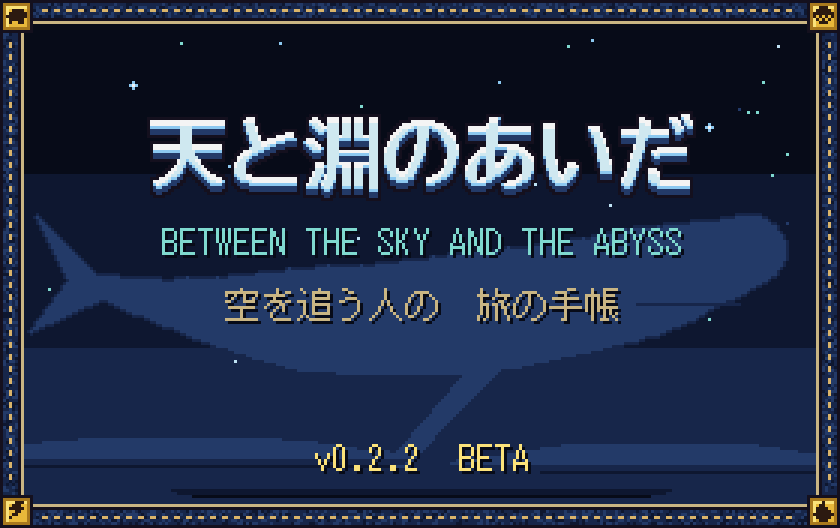

  

# 天と淵のあいだ（Between the Sky and the Abyss）

一枚の大陸を歩き、空を泳ぐ巨神の背に乗り、世界の底の謎へ。Minecraft Java 版 1.21.1（NeoForge）向けの、Minecraft の見た目をした RPG mod です。
はじまりの島で職を選び、鐘の都から四つの土地へ。巨神の背の試練を越えて心臓を止め、地の底の深淵へ降り、月へ渡ります。

- **6 職**（戦士・鍛冶師・魔法使い・弓使い・暗殺者・呪術師）。持った武器で職が決まり、持ち替えればその場で替わります。
- **巨神 1 体につき 1 章**。背は順路の部屋（歩・智・闘）→ 心臓の間。心臓を止めると巨神は眠り、祠から周回できます。
- **掘らない・建てない・作らない**。アドベンチャーモードの RPG で、倒れても持ち物は落とさず、装備はすり減りません。
- **6 人までのパーティ**。背の進みはパーティごとで、人数に合わせて敵が増えます。

**遊び方・職と技・装備・パーティなど、くわしいことは公式サイトにまとめています。**

### [公式サイトを開く: nishi-yura.github.io/skyabyss](https://nishi-yura.github.io/skyabyss/)

| 見たいもの | ページ |
| --- | --- |
| 何ができるか | [トップ](https://nishi-yura.github.io/skyabyss/) |
| 最初の 1 時間、操作キー | [遊び方](https://nishi-yura.github.io/skyabyss/play.html) |
| 四体の巨神と背中の試練 | [巨神と背中](https://nishi-yura.github.io/skyabyss/titans.html) |
| 6 職の技、刻印、型 | [職と技](https://nishi-yura.github.io/skyabyss/skills.html) |
| 導入の手順、サーバー管理者向けの設定 | [導入・FAQ](https://nishi-yura.github.io/skyabyss/faq.html) |
| 物語 | [物語](https://nishi-yura.github.io/skyabyss/story.html) |

## かんたんな導入

1. NeoForge 1.21.1 を入れて、一度起動する。
2. `skyabyss-0.9.20.jar` と GeckoLib の jar を、どちらも `mods` フォルダへ入れる（サーバーなら、サーバーの `mods` にも）。
3. **新しいワールド**を作る。世界の種類は「天と淵の大陸」だけです（専用サーバーは `server.properties` に `level-type=skyabyss\:continent`）。難易度はピースフル以外。一人でも、仲間と 6 人までで遊べます（みんなで同じ jar を）。

jar は開発者から受け取るか、ソースから `./gradlew build` で作ると `build/libs/` に出ます。テスター向けの案内は [docs/beta_how_to_play.md](docs/beta_how_to_play.md)。

## 必要なもの

| もの | 内容 |
| --- | --- |
| Minecraft | Java 版 1.21.1 |
| 導入先 | NeoForge 1.21.1（開発では 21.1.259） |
| 必要な mod | GeckoLib（NeoForge 1.21.1 用。開発では 4.9.3） |
| Java | 21 |

## ライセンス

All Rights Reserved。作 Nishi-Yura。巨神の動きに GeckoLib を使っています。

  これはベータ版（0.9.20）です。序章から終章「雲海」まで遊べます（既知の制限は<a href="https://nishi-yura.github.io/skyabyss/faq.html#limits">サイトの導入・FAQ</a>）。 
  <code>docs/design/</code> の設計書には物語の核心が書かれています。まっさらな気持ちで遊びたい人は開かないでください。

