

  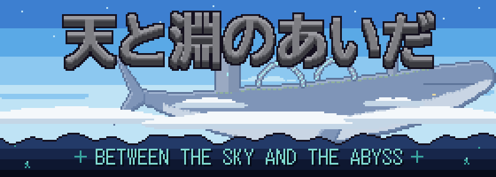

  
  
  
  

  <em>空を、何かが通った。</em> 
  <em>山より大きな影が、雲の上を、音もなく。</em>

  <a href="#features"><b>できること</b></a> &nbsp;|&nbsp;
  <a href="#start"><b>はじめかた</b></a> &nbsp;|&nbsp;
  <a href="#keys"><b>操作</b></a> &nbsp;|&nbsp;
  <a href="#more"><b>もっと知りたいとき</b></a>

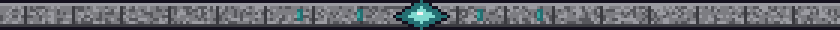

**天と淵のあいだ** は、Minecraft Java 版 1.21.1（NeoForge）向けの RPG mod です。

いつもの世界に、静かな異変がしのび込みます。空を横切る影。夜、遠くに立つ人影。村人が語る古い数え歌。
やがてあなたは、空を泳ぎ、海を歩き、嵐をまとい、地の底を泳ぐ **四体の巨神** に出会い、その背に乗り込むことになります。

建築も、採掘も、いつものマイクラのまま。そこに、怖さと冒険と、少しずつ解けていく謎が重なります。

> **ベータ版（v0.1.0）** です。序章から、四体の巨神を越えるところまで遊べます。

<h2 align="center">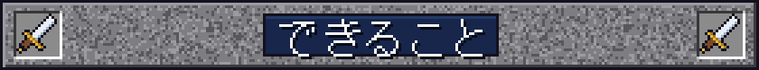</h2>

  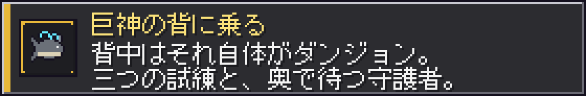 
  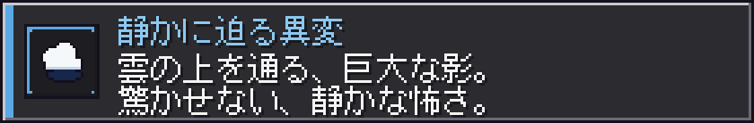 
  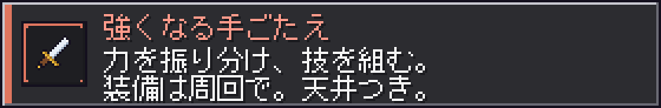 
  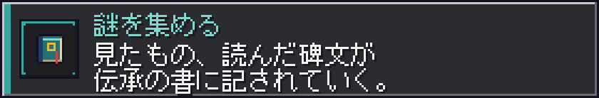 
  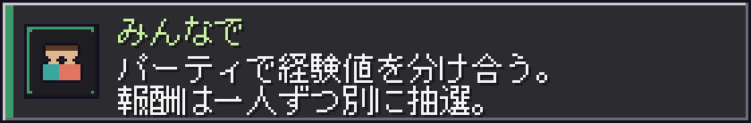

<table align="center">
  <tr>
    <td align="center">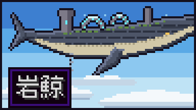 <b>岩鯨</b>　雲の上を泳ぐ、山のような影</td>
    <td align="center">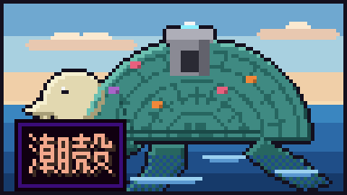 <b>潮殻</b>　海を歩く、珊瑚の甲羅</td>
  </tr>
  <tr>
    <td align="center">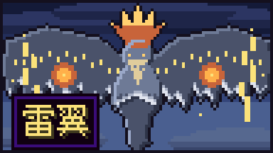 <b>雷翼</b>　嵐をまとう、青と金の翼</td>
    <td align="center">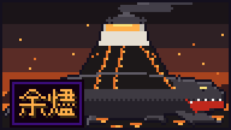 <b>余燼</b>　地を泳ぐ、熾火の体</td>
  </tr>
</table>

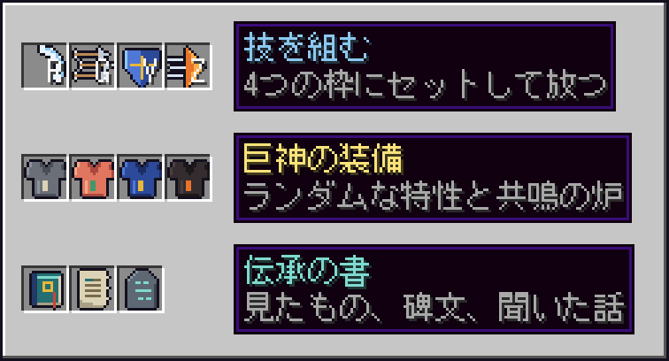

<b>くわしく見る</b>

- **巨神の背**：鎖、潮門、昇り風、熱い口。乗り方も巨神ごとに違います。背中には、それぞれ違う **三つの試練** と、体の奥で待つ強大な守護者。アスレチック、謎解き、群れとの戦い。毎回少しずつ形が変わるので、何度でも挑めます。
- **静かな異変**：晴れた日、雲の上を **巨大な影** が通りすぎる。地面がかすかに震え、動物たちは身をすくめる。夜、ひとりでいると、遠くに **誰かが立っている** ことがある。驚かせる演出には頼りません。「いつもと何かが違う」怖さです。
- **レベルとステータス**：力・敏捷・精神・耐久を自分で振り分け。
- **技**：剣士と弓使いの技を自由に組み合わせ、4つの枠にセットしてキーひとつで放つ。
- **巨神ごとの装備**：立体で見える防具と武器、ランダムな特性、共鳴の炉での強化と再鍛造。欲しい装備は周回で狙う。運が悪くても、いつかは必ず手に入る「天井」つき。
- **伝承の書**：見たもの、読んだ碑文、聞いた話が少しずつ記されていく。村の **語り部** や、空を追う旅人との会話。メインクエストと、自由に遊べるサブクエスト、日替わり・週替わりの依頼。
- **マルチプレイ**：**パーティ** を組めば、近くの仲間と経験値を分け合える。背中の試練は、人数に合わせて敵が増える。報酬は一人ずつ別々に抽選されるので、取り合いになりません。

<h2 align="center">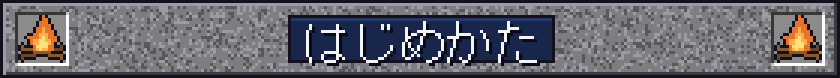</h2>

### 必要なもの

| もの | バージョン |
| --- | --- |
| Minecraft Java 版 | 1.21.1 |
| NeoForge | 1.21.1 |
| GeckoLib | NeoForge 1.21.1 用 |
| Java | 21 |

`skyabyss-0.1.0.jar` と GeckoLib を `mods` フォルダに入れて起動します。
ソースから作るときは `./gradlew build`（`build/libs/` にできます）。

- **新しいワールド** で始めてください。
- 難易度は **ピースフル以外** に（ピースフルでは巨神の試練が眠ったままです）。

### 最初の道のり

<table>
  <tr>
    <td width="72">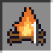</td>
    <td><b>野営地で目覚める。</b> 目を開けると、人が去った跡の野営地。消えた焚き火、倒れた荷車、開いたままの寝袋。</td>
  </tr>
  <tr>
    <td>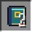</td>
    <td><b>古い帳面を拾う。</b> 落ちている帳面が、<b>伝承の書</b> の最初のページになります。</td>
  </tr>
  <tr>
    <td>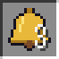</td>
    <td><b>煙と鐘の音を追う。</b> 遠くに細い煙の柱。ときどき鐘の音。道には積み石が並び、着いた先が <b>鐘の宿り</b> です。</td>
  </tr>
  <tr>
    <td>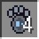</td>
    <td><b>足跡を見つける。</b> 道の脇に、人の足の形をした巨大なくぼみが並んでいます。</td>
  </tr>
  <tr>
    <td>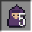</td>
    <td><b>語り部に会う。</b> 鐘の宿りで話しかけると、物語が動き出します。</td>
  </tr>
  <tr>
    <td>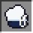</td>
    <td><b>空を見上げる。</b> 雲の上を、大きな影が通ります。そのあと、空から何かが落ちてきます。拾ってください。</td>
  </tr>
  <tr>
    <td>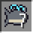</td>
    <td><b>空を泳ぐものを追う。</b> 村の外れの旅人が、岩鯨の話をしてくれます。あとは、自分の目で確かめてください。</td>
  </tr>
</table>

迷ったら **U キー**（クエストログ）を開きましょう。次に何をすればいいかが書いてあります。

<h2 align="center"></h2>

<table align="center">
  <tr>
    <td align="center" width="90"></td>
    <td>ステータス</td>
    <td align="center" width="90">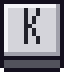</td>
    <td>技</td>
  </tr>
  <tr>
    <td align="center"></td>
    <td>クエストログ</td>
    <td align="center"></td>
    <td>控え帳（巨神の記録・大事な品）</td>
  </tr>
  <tr>
    <td align="center"></td>
    <td>パーティ</td>
    <td align="center"></td>
    <td>護符を使う</td>
  </tr>
  <tr>
    <td align="center" colspan="2">
       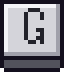 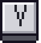 
    </td>
    <td colspan="2">技の枠 1〜4</td>
  </tr>
</table>

キーは設定の「操作」→「天と淵のあいだ」で変えられます。

<h2 align="center">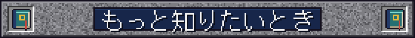</h2>

- テスター向けの詳しい遊び方：[docs/beta_how_to_play.md](docs/beta_how_to_play.md)
- ベータ版の範囲と既知の問題：[docs/design/14_beta.md](docs/design/14_beta.md)

> **注意** `docs/design/` の設計書には、物語の核心が書かれています。まっさらな気持ちで遊びたい人は、開かないでください。

<h2 align="center">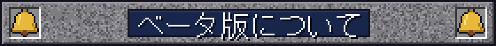</h2>

まだ作りかけの部分があります。四体の巨神を越えた先の物語は、これから続いていきます。
遊んでみて気づいたことがあれば、ぜひ教えてください。

  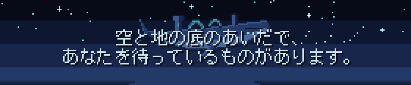

