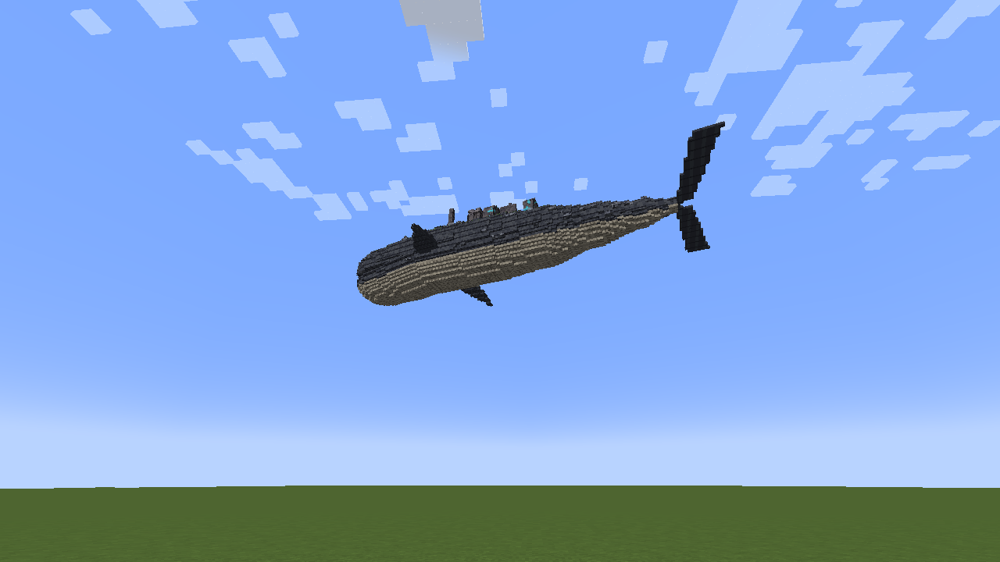
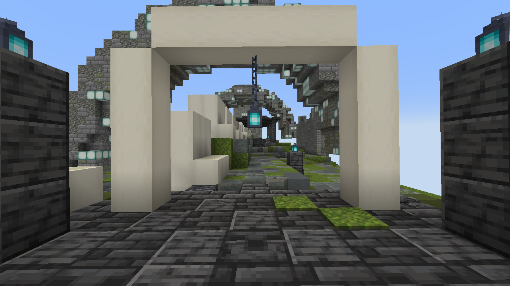
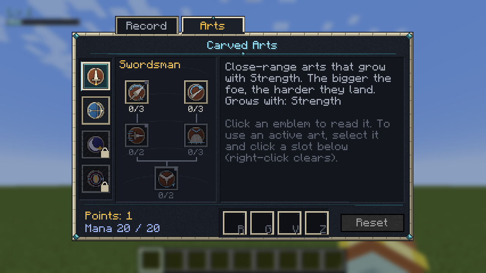
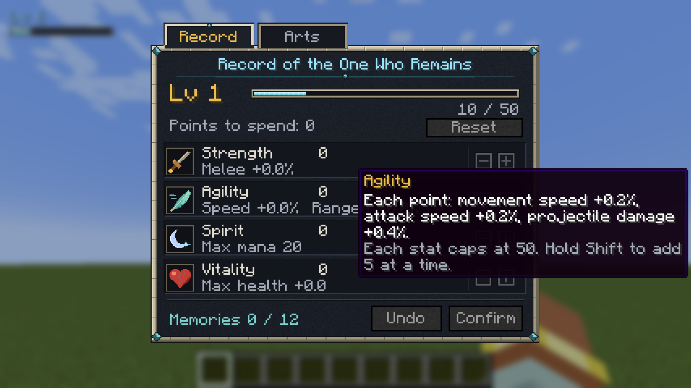
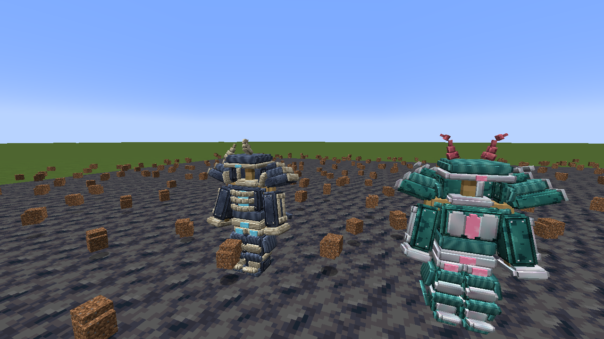

  

  
  
  
  

  <em>空を、何かが通った。</em> 
  <em>山より大きな影が、雲の上を、音もなく。</em>

  <a href="#できること">できること</a> ・
  <a href="#はじめかた">はじめかた</a> ・
  <a href="#操作">操作</a> ・
  <a href="#もっと知りたいとき">もっと知りたいとき</a>

---

**天と淵のあいだ** は、Minecraft Java 版 1.21.1（NeoForge）向けの RPG mod です。

いつもの世界に、静かな異変がしのび込みます。空を横切る影。夜、遠くに立つ人影。村人が語る古い数え歌。
やがてあなたは、空を泳ぎ、海を歩き、嵐をまとい、地の底を泳ぐ **四体の巨神** に出会い、その背に乗り込むことになります。

建築も、採掘も、いつものマイクラのまま。そこに、怖さと冒険と、少しずつ解けていく謎が重なります。

> 🌌 いまは **ベータ版（v0.1.0）** です。序章から、四体の巨神を越えるところまで遊べます。

---

## できること

### 🐋 巨神の背に乗る

  
   雲の上を泳ぐ、山のような影。地上から見上げると、こんなふうに見えます。

- 空を泳ぐ **岩鯨**、海を歩く **潮殻**、嵐をまとう **雷翼**、地を泳ぐ **余燼**。
- 巨神の背中は、それ自体がひとつのダンジョン。鎖、潮門、昇り風、熱い口。乗り方も巨神ごとに違います。
- 背中には、それぞれ違う **三つの試練** と、体の奥で待つ強大な守護者。
- アスレチック、謎解き、群れとの戦い。毎回少しずつ形が変わるので、何度でも挑めます。

| 海を歩く **潮殻** | 嵐をまとう **雷翼** |
| :---: | :---: |
|  |  |
| **地を泳ぐ 余燼** | **巨神の背のダンジョン** |
|  |  |

### 🌫 静かに迫る異変
- 晴れた日、雲の上を **巨大な影** が通りすぎる。地面がかすかに震え、動物たちは身をすくめる。
- 夜、ひとりでいると、遠くに **誰かが立っている** ことがある。
- 驚かせる演出には頼りません。「いつもと何かが違う」怖さです。

### ⚔ 強くなる手ごたえ

| 技を組む | 力を振り分ける |
| :---: | :---: |
|  |  |

- **レベルとステータス**：力・敏捷・精神・耐久を自分で振り分け。
- **技**：剣士と弓使いの技を自由に組み合わせ、4つの枠にセットしてキーひとつで放つ。
- **巨神ごとの装備**：立体で見える防具と武器、ランダムな特性、共鳴の炉での強化と再鍛造。
- 欲しい装備は周回で狙う。運が悪くても、いつかは必ず手に入る「天井」つき。

  
   巨神ごとに姿の違う防具。立体のまま、体にまとえます。

### 📖 謎を集める
- 見たもの、読んだ碑文、聞いた話が **伝承の書** に少しずつ記されていく。
- 村の **語り部** や、空を追う旅人との会話。メインクエストと、自由に遊べるサブクエスト、日替わり・週替わりの依頼。

### 👥 みんなで
- マルチプレイ対応。**パーティ** を組めば、近くの仲間と経験値を分け合える。
- 背中の試練は、人数に合わせて敵が増える。報酬は一人ずつ別々に抽選されるので、取り合いになりません。

---

## はじめかた

### 必要なもの
| もの | バージョン |
| --- | --- |
| Minecraft Java 版 | 1.21.1 |
| NeoForge | 1.21.1 |
| GeckoLib | NeoForge 1.21.1 用 |
| Java | 21 |

`skyabyss-0.1.0.jar` と GeckoLib を `mods` フォルダに入れて起動します。
ソースから作るときは `./gradlew build`（`build/libs/` にできます）。

- **新しいワールド** で始めてください。
- 難易度は **ピースフル以外** に（ピースフルでは巨神の試練が眠ったままです）。

### 最初の数日
1. **いつもどおり暮らす。** 家を建て、道具をそろえ、夜を越えましょう。
2. **空を見上げる。** 数日のうちに、空を大きな影が通ります。そのあと、空から何かが落ちてきます。拾ってください。
3. **村をたずねる。** 鐘のそばの **語り部** に話しかけると、物語が動き出します。
4. **旅人をさがす。** 話が進むと、村の外れに焚き火がともります。
5. **空を泳ぐものを追う。** あとは、自分の目で確かめてください。

迷ったら **U キー**（クエストログ）を開きましょう。次に何をすればいいかが書いてあります。

---

## 操作

| キー | できること |
| --- | --- |
| **J** | ステータス |
| **K** | 技 |
| **U** | クエストログ |
| **B** | 控え帳（巨神の記録・大事な品） |
| **O** | パーティ |
| **H** | 護符を使う |
| **R / G / V / Z** | 技の枠 1〜4 |

キーは設定の「操作」→「天と淵のあいだ」で変えられます。

---

## もっと知りたいとき

- テスター向けの詳しい遊び方：[docs/beta_how_to_play.md](docs/beta_how_to_play.md)
- ベータ版の範囲と既知の問題：[docs/design/14_beta.md](docs/design/14_beta.md)

> ⚠ `docs/design/` の設計書には、物語の核心が書かれています。まっさらな気持ちで遊びたい人は、開かないでください。

---

## ベータ版について

まだ作りかけの部分があります。四体の巨神を越えた先の物語は、これから続いていきます。
遊んでみて気づいたことがあれば、ぜひ教えてください。

*空と地の底のあいだで、あなたを待っているものがあります。*
