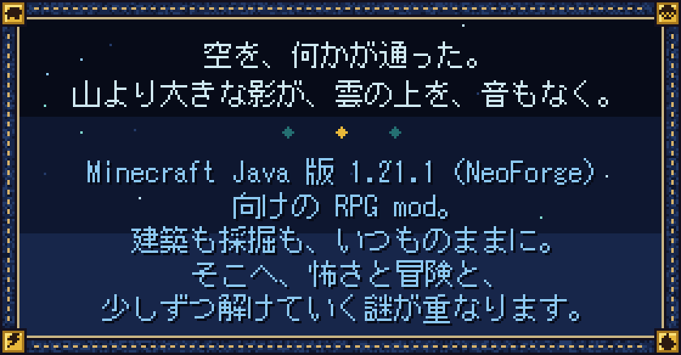
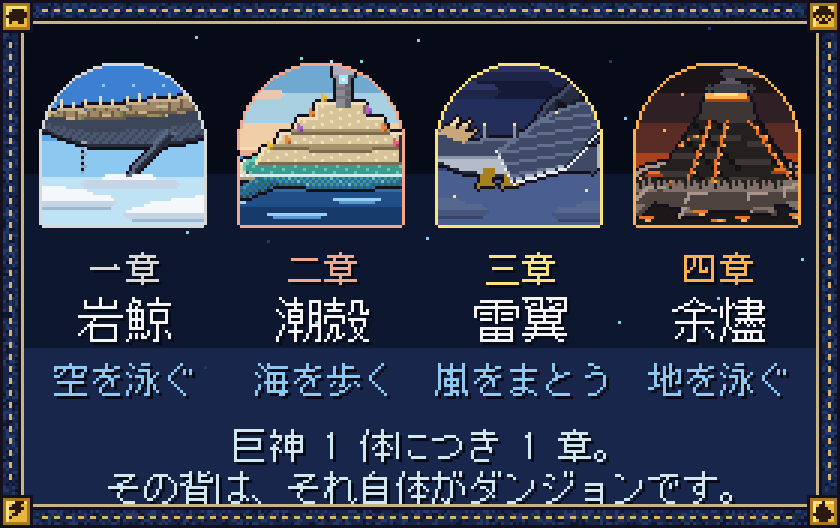
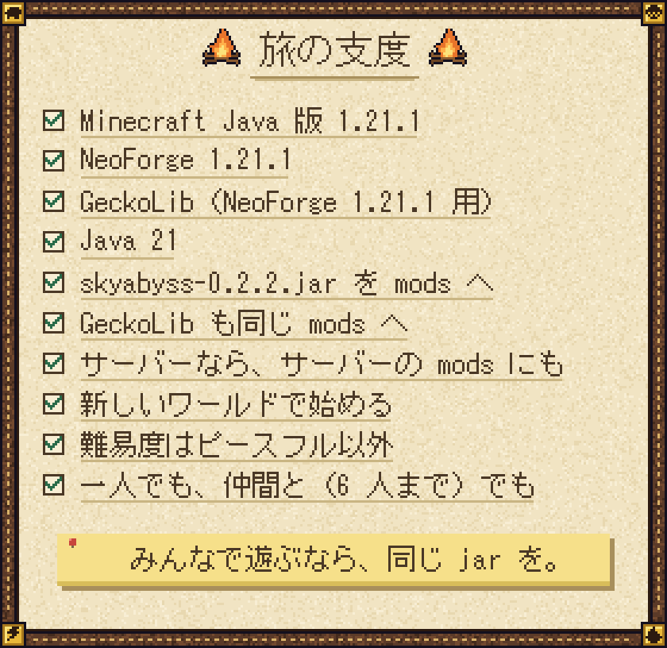
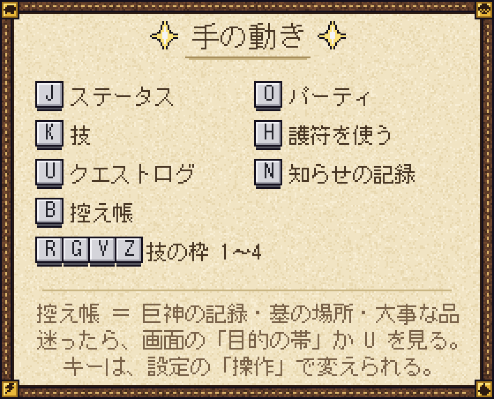
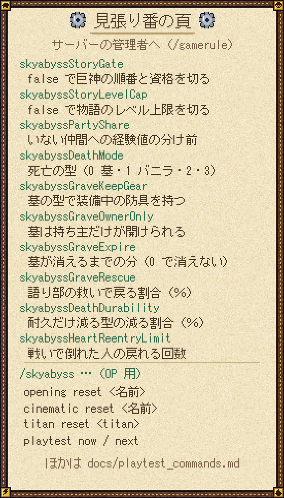
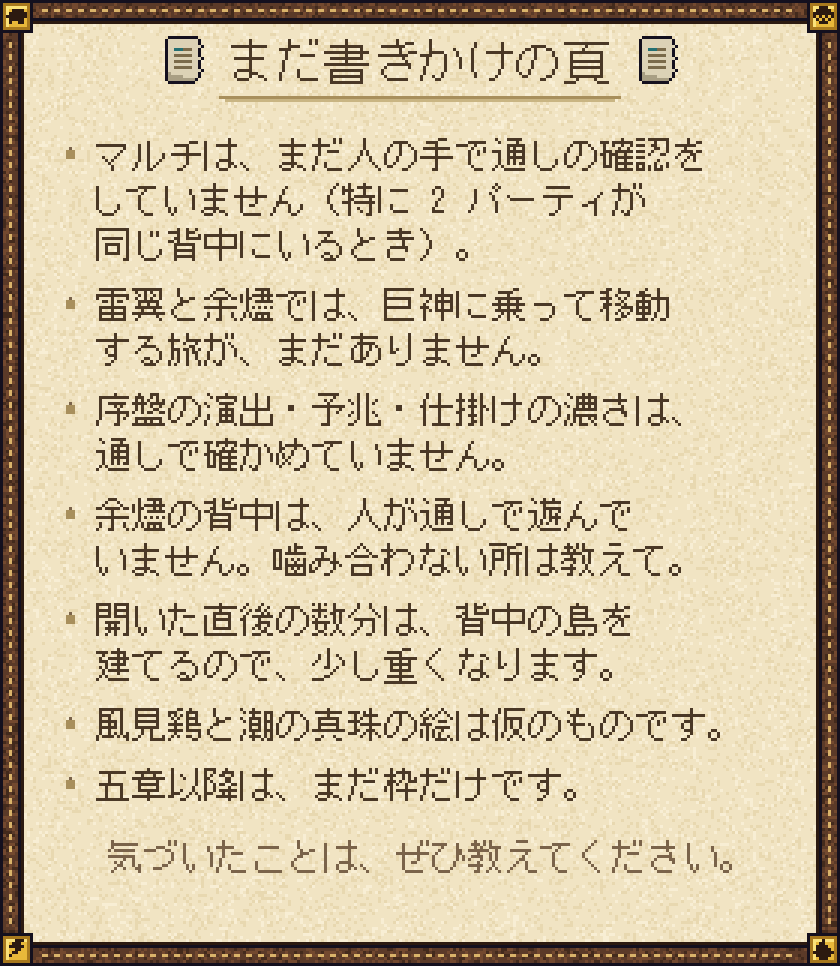
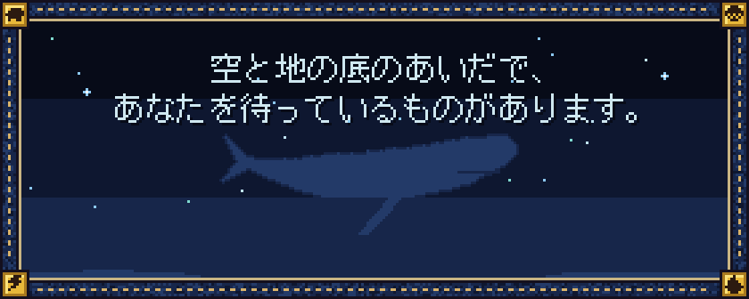
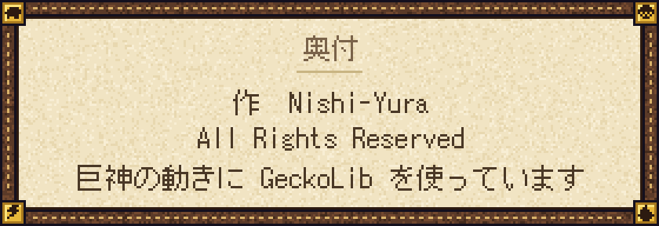

  

  

  

  

  

  

管理者向けの表（コピーできる文字版）

`/gamerule` で決まりを変えられます。

| ゲームルール | 内容 |
| --- | --- |
| `skyabyssStoryGate` | `false` で巨神の順番と乗る資格の決まりを切る（好きな順に乗れる） |
| `skyabyssStoryLevelCap` | `false` で物語の進みによるレベル上限を切る |
| `skyabyssPartyShare` | その場にいなかった仲間への経験値の分け前（50〜80 %） |
| `skyabyssDeathMode` | 地上で倒れたときの型（0 墓 / 1 バニラ / 2 全部残す / 3 耐久だけ減る。既定 0） |
| `skyabyssGraveKeepGear` | 墓の型で、装備中の防具を持って復活する（既定 true） |
| `skyabyssGraveOwnerOnly` | 墓を開けられるのは持ち主だけ（既定 true） |
| `skyabyssGraveExpire` | 墓が消えるまでの分（0 で消えない） |
| `skyabyssGraveRescue` | 語り部の救いで戻る割合（％。0 で救いなし） |
| `skyabyssDeathDurability` | 耐久だけ減る型での減る割合（％） |
| `skyabyssHeartReentryLimit` | 戦いで倒れた人が、20 秒のあとに戻れる回数（既定 3。0 で数えない） |

OP（権限 2）用の `/skyabyss` コマンド:

| コマンド | 働き |
| --- | --- |
| `/skyabyss opening reset <名前>` | 序章を、もう一度遊べるように戻す |
| `/skyabyss cinematic reset <名前>` | 見た扱いの場面を戻す |
| `/skyabyss titan reset <titan>` | その巨神の進みを戻す（例: `/skyabyss titan reset ember`） |
| `/skyabyss playtest now` | 今の目的の出来事を、その場で起こす |
| `/skyabyss playtest next` | 今の目的を済ませて、次へ進める |

試遊用コマンドの全部は [docs/playtest_commands.md](docs/playtest_commands.md) にあります。設定ファイルでは、不穏な出来事の頻度を変えられます（`horrorEventFrequency` など。0 で出なくなります）。

  

  

  

  詳しい遊び方：<a href="docs/beta_how_to_play.md">docs/beta_how_to_play.md</a>　／　ベータ版の範囲：<a href="docs/design/14_beta.md">docs/design/14_beta.md</a> 
  <code>docs/design/</code> の設計書には物語の核心が書かれています。まっさらな気持ちで遊びたい人は開かないでください。

