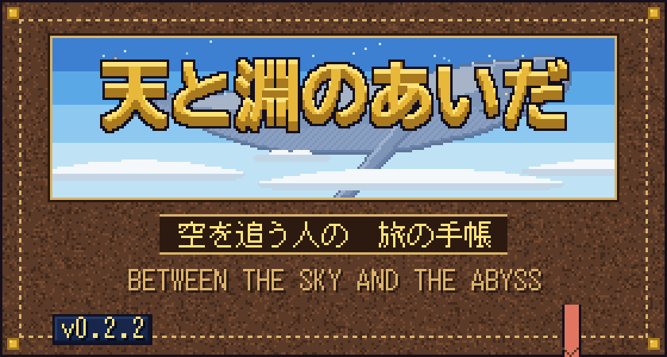
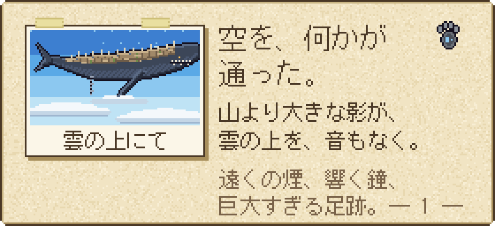
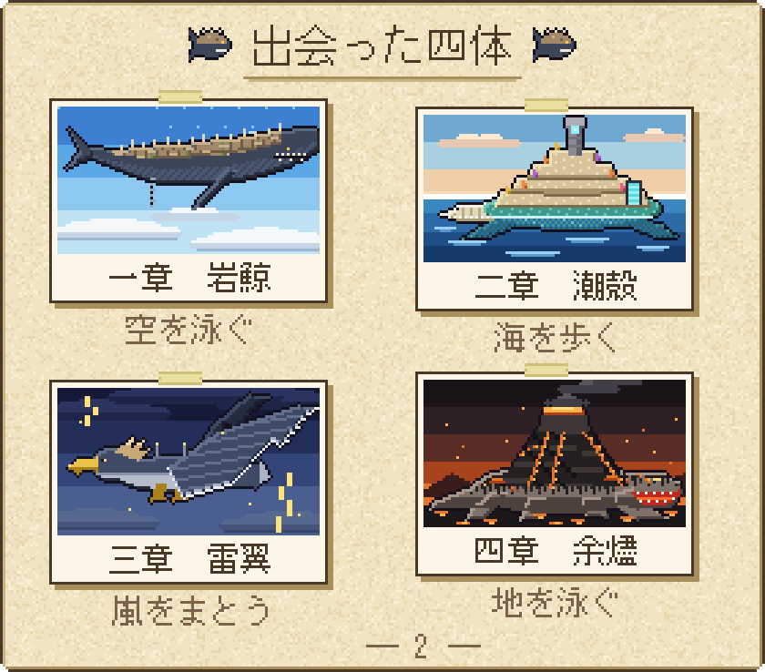
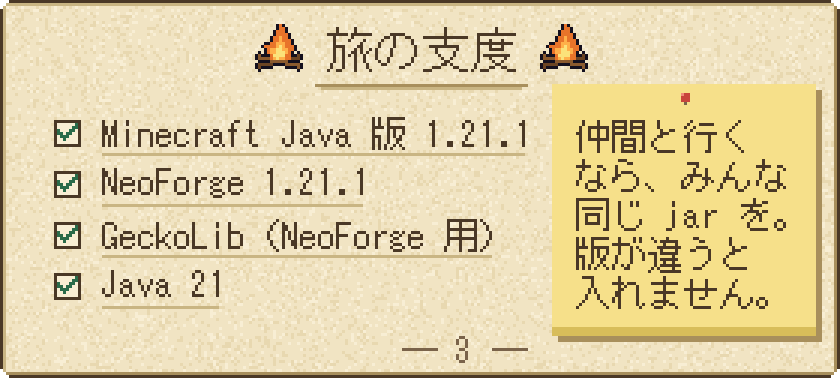
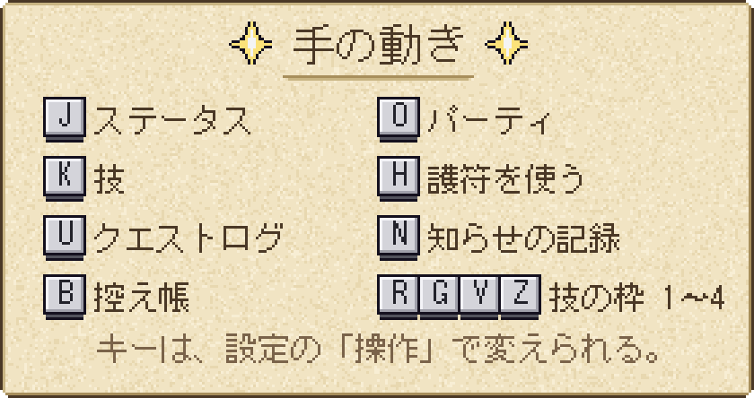
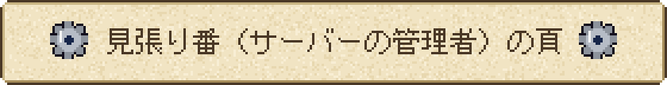
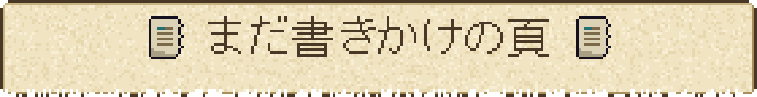
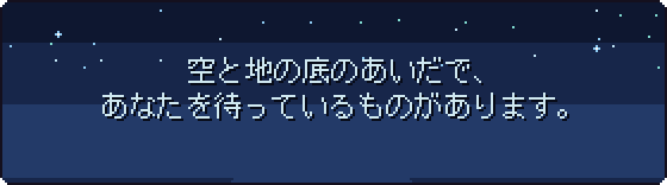

  

  Minecraft Java 版 1.21.1（NeoForge）向けの RPG mod です。 
  建築も採掘も、いつものマイクラのまま。 
  そこに、怖さと冒険と、少しずつ解けていく謎が重なります。

 

  

  目を開けると、そこは見知らぬ野営地。 
  人が去った跡と、一冊の古い帳面だけがあります。 
  帳面を拾い、煙と鐘の音をたどって、あなたは旅を始めます。

 

  

  空を泳ぎ、海を歩き、嵐をまとい、地の底を泳ぐ。 
  四体の巨神に出会い、その背に乗り込みます。 
  背中はそれ自体がダンジョン。三つの試練と、体の奥で待つ守護者が、あなたを待っています。 
  物語は巨神 1 体につき 1 章。仲間とは 6 人まで、同じ旅ができます。

  ベータ版（v0.2.2）です。序章と四つの章を越えて、「天の鍵」がそろうところまで遊べます。

 

  

  <code>skyabyss-0.2.2.jar</code> と GeckoLib の jar を、どちらも <code>mods</code> フォルダへ。 
  サーバーで遊ぶなら、サーバーの <code>mods</code> にも同じものを入れます。 
  新しいワールドで、ピースフル以外の難易度で始めてください。 
  ソースから作るときは <code>./gradlew build</code>（<code>build/libs/</code> にできます）。

  最初に世界へ入ると、暗い画面から始まります。少し待ってください。 
  迷ったら画面の「目的の帯」を見るか、<kbd>U</kbd> キーでクエストログを開きます。

 

  

 

 

`/gamerule` で決まりを変えられます。

| ゲームルール | 内容 |
| --- | --- |
| `skyabyssStoryGate` | `false` で巨神の順番と乗る資格の決まりを切る |
| `skyabyssStoryLevelCap` | `false` で物語の進みによるレベル上限を切る |
| `skyabyssPartyShare` | その場にいなかった仲間への経験値の分け前（50〜80 %） |
| `skyabyssDeathMode` | 地上で倒れたときの型（0 墓 / 1 バニラ / 2 全部残す / 3 耐久だけ減る。既定 0） |
| `skyabyssGraveKeepGear` | 墓の型で、装備中の防具を持って復活する（既定 true） |
| `skyabyssGraveOwnerOnly` | 墓を開けられるのは持ち主だけ（既定 true） |
| `skyabyssGraveExpire` | 墓が消えるまでの分（0 で消えない） |
| `skyabyssGraveRescue` | 語り部の救いで戻る割合（％。0 で救いなし） |
| `skyabyssDeathDurability` | 耐久だけ減る型での減る割合（％） |
| `skyabyssHeartReentryLimit` | 戦いで倒れた人が、20 秒のあとに戻れる回数（既定 3） |

詰まったときのためのコマンドが `/skyabyss` にそろっています（巨神を呼ぶ、背中から戻す、場面を流す、進みを戻す、など）。一覧とテスター向けの手順は [beta_how_to_play.md](../../../beta_how_to_play.md) にあります。

 

作りかけの部分があります。気づいたことがあれば、ぜひ教えてください。

マルチプレイは、まだ人の手で通しの確認をしていません。特に、2 つのパーティが同じ背中にいるときの動きです。雷翼と余燼では、巨神に乗って移動する旅がまだできません。序盤の演出や章の小さな仕掛けは、濃さ（出すぎる・気づかない）の感想をください。世界を開いた直後の数分は、背中の島を建てているので動きが重いことがあります。五章以降は、まだ枠だけです。

 

  

  
    作：Nishi-Yura　／　ライセンス：All Rights Reserved 
    アニメーションに <a href="https://github.com/bernie-g/geckolib">GeckoLib</a> を使っています。
  

