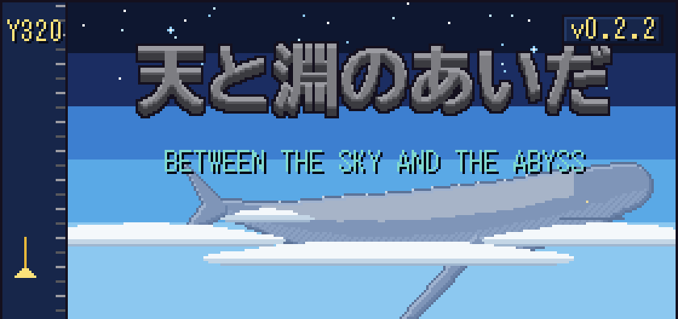
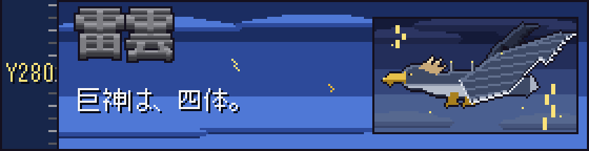
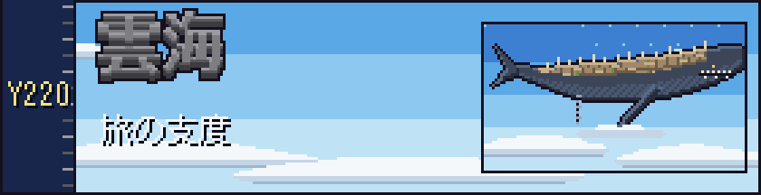
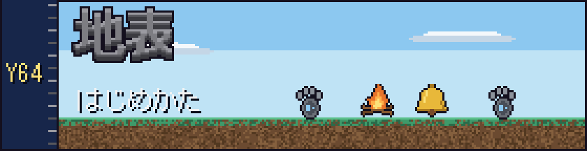
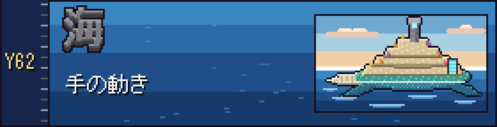
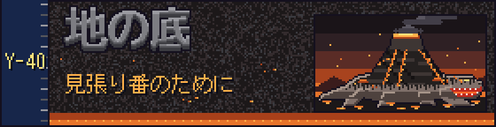
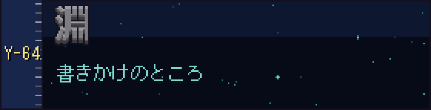

  

  <em>空を、何かが通った。</em> 
  <em>山より大きな影が、雲の上を、音もなく。</em>

  Minecraft Java 版 1.21.1（NeoForge）向けの RPG mod です。 
  この頁は、空の高みから地の底の淵まで、上から順に降りていく地図です。 
  下へ降りるほど、遊ぶための細かい話になります。

ベータ版 v0.2.2　序章と四つの章、天の鍵がそろうところまで

  

  雲より高いところには、嵐をまとうものがいます。 
  空を泳ぐもの、海を歩くもの、嵐をまとうもの、地の底を泳ぐもの。 
  <b>一章 岩鯨　二章 潮殻　三章 雷翼　四章 余燼</b> 
  巨神 1 体につき 1 章。背中はそれ自体がダンジョンで、三つの試練と、奥で待つ守護者がいます。

  

  雲の海を渡るには、これだけあれば足ります。 
  Minecraft Java 版 <b>1.21.1</b>　・　NeoForge <b>1.21.1</b>　・　GeckoLib（NeoForge 用）　・　Java <b>21</b> 
  仲間と遊ぶなら、全員が同じ版の jar を入れてください。版が違うと、接続のときに断られます。

  

  <code>skyabyss-0.2.2.jar</code> と GeckoLib の jar を、<code>mods</code> フォルダへ入れて起動します。 
  サーバーなら、サーバーの <code>mods</code> にも同じものを。 
  新しいワールド、ピースフル以外の難易度で始めてください（6 人まで）。

  目覚めるのは、人が去った野営地です。 
  遠い煙、鐘の音、道の脇の巨大な足跡をたどると、鐘の宿りに着きます。 
  迷ったら「目的の帯」を見るか、<kbd>U</kbd> でクエストログを。

  

  <kbd>J</kbd> ステータス　<kbd>K</kbd> 技　<kbd>U</kbd> クエストログ　<kbd>B</kbd> 控え帳（墓の場所もここ） 
  <kbd>O</kbd> パーティ　<kbd>H</kbd> 護符を使う　<kbd>N</kbd> 知らせの記録 
  <kbd>R</kbd> <kbd>G</kbd> <kbd>V</kbd> <kbd>Z</kbd> 技の枠 1〜4 
  キーは、設定の「操作」→「天と淵のあいだ」で変えられます。

  

  サーバーの管理者へ。<code>/gamerule</code> で決まりを変えられます。

| ゲームルール | 内容 |
| :-- | :-- |
| `skyabyssStoryGate` | `false` で巨神の順番と乗る資格の決まりを切る |
| `skyabyssStoryLevelCap` | `false` でレベル上限を切る |
| `skyabyssPartyShare` | その場にいなかった仲間への経験値の分け前（50〜80 %） |
| `skyabyssDeathMode` | 倒れたときの型（0 墓 / 1 バニラ / 2 全部残す / 3 耐久だけ。既定 0） |
| `skyabyssHeartReentryLimit` | 戦いで倒れた人が戻れる回数（既定 3） |

  墓まわりのルール（<code>skyabyssGrave*</code>）や、詰まったときの <code>/skyabyss</code> コマンドは、<a href="../../../beta_how_to_play.md">beta_how_to_play.md</a> にまとめています。

  

  いちばん下は、まだ作りかけです。 
  マルチプレイは、人の手で通しの確認をしていません（特に 2 つのパーティが同じ背中にいるとき）。 
  雷翼と余燼は、巨神に乗って移動する旅がまだできません。 
  五章以降は、枠だけです。

  気づいたことがあれば、ぜひ教えてください。 
  作：Nishi-Yura　／　ライセンス：All Rights Reserved　／　GeckoLib を使っています

