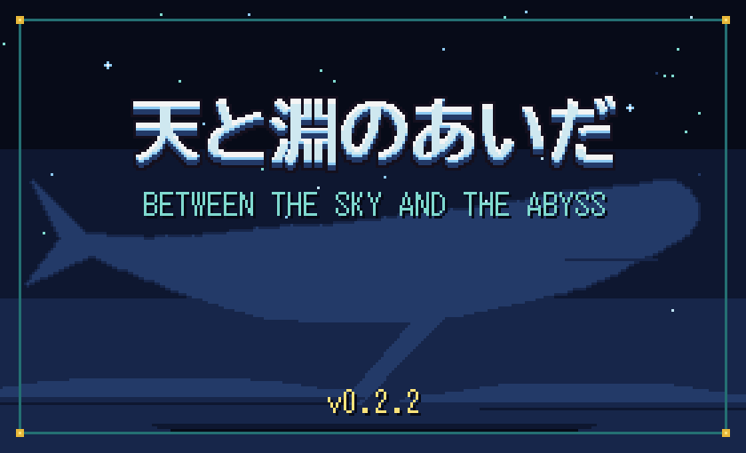
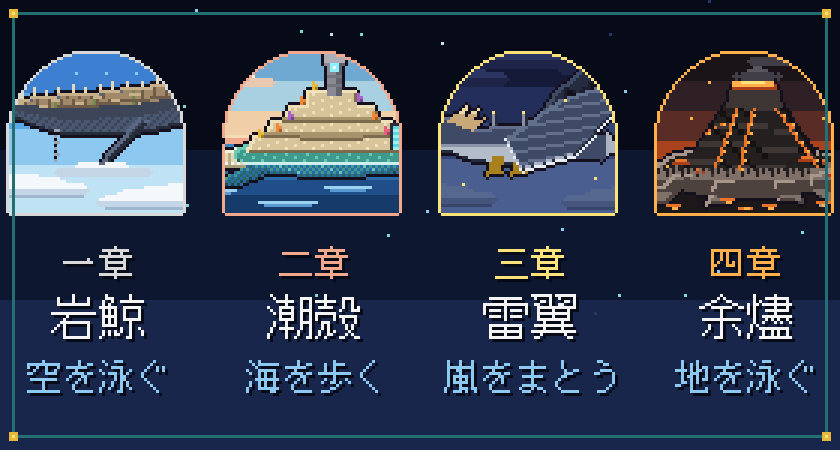
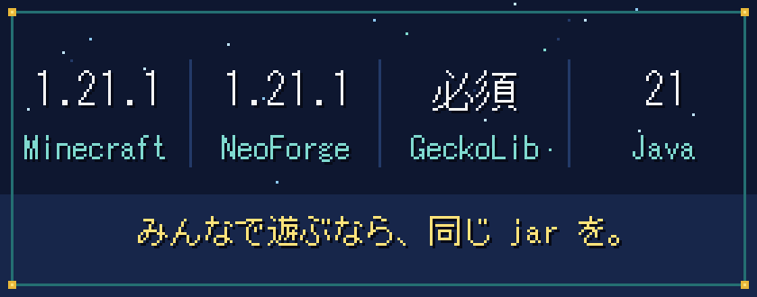
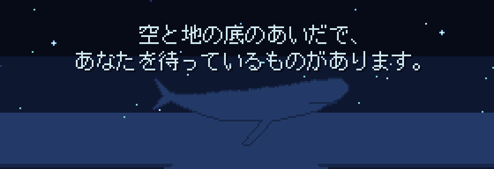

  

 

  空を、何かが通った。 
  山より大きな影が、雲の上を、音もなく。

  

  Minecraft Java 版 1.21.1（NeoForge）向けの RPG mod。 
  建築も採掘も、いつものままに。 
  そこへ、怖さと冒険と、少しずつ解けていく謎が重なります。

  

  

  巨神 1 体につき 1 章。 
  その背に乗り込めば、背中はそれ自体がダンジョンです。

  

  

  <code>skyabyss-0.2.2.jar</code> と GeckoLib を <code>mods</code> フォルダへ。 
  サーバーにも、同じものを。 
  新しいワールドで、ピースフル以外の難易度で。6 人まで。

 

  <kbd>J</kbd> ステータス　<kbd>K</kbd> 技　<kbd>U</kbd> クエストログ　<kbd>B</kbd> 控え帳 
  <kbd>O</kbd> パーティ　<kbd>H</kbd> 護符　<kbd>N</kbd> 知らせの記録　<kbd>R</kbd> <kbd>G</kbd> <kbd>V</kbd> <kbd>Z</kbd> 技の枠

  

  

 

  ベータ版 v0.2.2　序章から天の鍵がそろうところまで

サーバーの管理者へ

 

`/gamerule` で決まりを変えられます。

| ゲームルール | 内容 |
| --- | --- |
| `skyabyssStoryGate` | `false` で巨神の順番と乗る資格の決まりを切る |
| `skyabyssStoryLevelCap` | `false` で物語の進みによるレベル上限を切る |
| `skyabyssPartyShare` | その場にいなかった仲間への経験値の分け前（50〜80 %） |
| `skyabyssDeathMode` | 倒れたときの型（0 墓 / 1 バニラ / 2 全部残す / 3 耐久だけ減る。既定 0） |
| `skyabyssHeartReentryLimit` | 戦いで倒れた人が戻れる回数（既定 3） |

墓まわり（`skyabyssGrave*`）のルールと、詰まったときの `/skyabyss` コマンドは [beta_how_to_play.md](../../../beta_how_to_play.md) に。

既知の問題

 

マルチプレイは、まだ人の手で通しの確認をしていません。特に、2 つのパーティが同じ背中にいるときの動きです。雷翼と余燼では、巨神に乗って移動する旅がまだできません。世界を開いた直後の数分は、背中の島を建てているので動きが重いことがあります。五章以降は、まだ枠だけです。

気づいたことがあれば、ぜひ教えてください。

クレジット

 

作：Nishi-Yura　／　ライセンス：All Rights Reserved　／　アニメーションに [GeckoLib](https://github.com/bernie-g/geckolib) を使っています。

