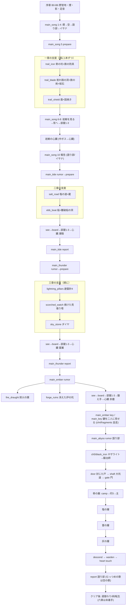

# クエストの流れ点検（2026-10-23）

- 対象: `origin/m1-sky-pass`（0.5.2 の試遊後・レイド順路実装済みの状態）。クエストデータ 81 本（`data/skyabyss/quest/**`、段 197、目的 235）を JSON から集計し、`tools/gen/{ch1..ch5,story}`・`story/*`・`trial/TrialRoute`・`trial/raid/*`・doc 34/32/33/21 と突き合わせた。ゲームデータは変えていない（読むだけ）。
- 未マージの `wip/world-fixes`（跡地を約 65% に近づける・道しるべの案内を撤去）は含めていない。マージ後に 3.1 の「石標」文言と距離の見積もりを見直すこと。
- 用語: 段階（stage）= 巨神を何体止めたか。序章・一章 0、二章 1、三章 2、四章 3、五章 4。クエスト JSON の `chapter` は内部 ID で、五章だけ `chapter2` のまま（旧 ID の名残。`Chapters.ABYSS`）。

---

## 1. メインクエストの流れ（序章 → 五章 → クリア後）

凡例: 段 ID →（目的 / 完了の仕方 / 経験値）。既定は全員の合算でなく「その人の持ち物・記録」で数える `party:false`、または仲間と合算の合図。「T」= 試練（レイドの部屋）。

### 1.0 序章「空の影」（クエスト JSON なし。拍子 B0〜B6 は `opening/`）

1. B0 目覚め → B1 野営地で帳面（伝承 `prologue/the_book`）→ B2 煙を追って町（鐘の宿り）→ B3 足跡 → B4 昼の空の影（破れた頁）→ B5 語り部 → B6 夜の足音。
2. 帳面か影を見ると **`main_song` が始まる**（`start_when`: 伝承 `prologue/the_book`・`prologue/shadow`・`chapter1/stone_whale` のどれか）。
3. 週替わり板 `ch1/day1_cairns`（積み石 2 回り）・`ch1/day1_firewood`（丸太 8）が序章の「初日のお使い」。

### 1.1 一章「空を泳ぐもの」岩鯨（Lv 4 → 12）

メイン `main_song`（語り部。10 段・経験値 310 + 報酬 200 = 510）

| # | 段 ID | 目的（要約） | 完了の仕方 | 次 |
|---|---|---|---|---|
| 1 | `follow_smoke`（20） | 煙の立つ方へ向かう | 語り部と話す `shadow0` | 2 |
| 2 | `watch_sky`（20） | 晴れた昼に空を見上げる | 伝承 `prologue/shadow`（B4） | 3 |
| 3 | `ask_storyteller`（30） | 語り部に空のことを尋ねる | 話す `shadow3` | 4 |
| 4 | `find_chaser`（30） | 焚き火のイサナに話を聞く（町の門の外） | 話す `c_whale2` | 5 |
| 5 | `prepare` | 鉄・刃・盾で鯨を迎える支度 | `condition`: `prep` 一章（下の 3 本がそろう） | 6 |
| 6 | `see_whale`（60） | 歌に耳をすまし岩鯨を探す | 伝承 `chapter1/stone_whale`（B10 初登場。支度のあと約 30 秒） | 7 |
| 7 | `board`（60） | 鎖を上って背へ | 伝承 `chapter1/sky_ruins` | 8 |
| 8 | `inscriptions`（90） | 三つの試練を越え碑文を読む | 部屋 1〜3 のクリアで `inscription_west/east/below` を自動で記す（`TrialRoute.WHALE_ROOM_INSCRIPTIONS`）。心臓を止めていれば飛ぶ | 9 |
| 9 | `heart` | 心臓を止め、欠片を取る | 伝承 `heart_stilled` と `sky_key` | 10 |
| 10 | `return`（any） | 語り部かイサナに欠片を見せる | 話す `fragment3` か `c_fragment2` | 完了（xp 200・好感度）→ `main_tide` |

支度の段 3 本（どれも `category: main`、順に 1 本ずつ。巨神を見る前だけ `stage max 0`）

| クエスト | 依頼主 | 段 | 経験値 | 行き先 |
|---|---|---|---|---|
| `ch1/trail_iron` | イサナ | `pit` 骨の坑の荷の頁 → `armor` 鉄の防具 4 部位を着る | 30+70 | 町の北の丘（骨の坑） |
| `ch1/trail_blade` | 旅の職人 | `hear` → `cave` 割れ殻の洞の折れた剣の頁 → `show` → `forge` 鉄の剣 + 砥石を一度使う | 30+70 | 割れ殻の洞 |
| `ch1/trail_shield` | 語り部 | `tale` → `pack` 盾 + 道の固焼き 8 | 0+50 | 町（作るだけ） |

- 場所: 町 → 北の丘（跡地。町から 240〜360）。骨の坑・割れ殻の洞・歌石は跡地の中。三本そろうと `ch1_ready`・記念品「鯨追いの印」・岩鯨の初登場。
- 背の中: 入口（鎖の先の階段）→ 部屋 1（歩）→ 部屋 2（智）→ 部屋 3（闘）→（中ボス）→ 心臓。クリア後に祠（跡地）から再挑戦。
- 報酬: 経験値のみ（アイテムなし）。装備の報酬は試練・心臓側（心臓の武器選び）。

### 1.2 二章「引く海」潮殻（Lv 12 → 18）

メイン `main_tide`（イサナ。7 段・250 + 300 = 550。開始条件: `main_song` 完了 かつ 岩鯨が止まっている）

1. `rumor`（40）: イサナの海の噂（話す `ms_c_tide2`）。
2. `prepare`: `prep` 二章 = 下の 2 本（`salt_road`、`ebb_boat`）。
3. `see`（60）: 潮と一緒に寄る島を見る（伝承 `tide_shell`）。
4. `board`（60）: 潮が引いたら門をくぐって背へ（伝承 `tide_ruins`）。
5. `inscriptions`（90）: 碑文 6 種のうち 2 つ（`beach/hub/west/east/front/heart`）。
6. `heart`: 心臓を止める（`stilled tide_shell`）。
7. `report`（any）: 語り部（`ms_tide_back2`）かイサナ（`ms_c_tide_back2`）→ 完了 xp 300 → `main_thunder`。

| 支度 | 依頼主 | 段 | 経験値 | 行き先 |
|---|---|---|---|---|
| `ch2/salt_road` | 語り部 | `road` 塩の道の標 5（合図 `ch2_salt_mark`）→ `vault` 蔵の刻み + 蔵のクリア | 100+80 | 東の浜（520〜900）→ 沈んだ塩の蔵 |
| `ch2/ebb_boat` | イサナ | `boat` 船 → `wreck` 難破船の頁 + 潮見の貝 | 90+90 | 浜の沖の難破船（船で渡る） |

- 背の中の流れは一章と同じ（部屋 1〜3 → 中ボス → 心臓）。

### 1.3 三章「風に逆らう嵐」雷翼（Lv 18 → 24）

メイン `main_thunder`（語り部。7 段・270 + 400 = 670。開始条件: `main_tide` 完了）

1. `rumor`（40）: 語り部に三つ目のことを尋ねる（`ms_thunder2`）。
2. `prepare`: `prep` 三章 = 下の 3 本（避雷の柱 → 焼けた見張り塔 → 空の石）。
3. `see`（80）: 風に逆らう嵐を探す（`thunder_wing`／`storm_wing`）。
4. `board`（60）: 峰で待ち昇り風で背へ（`storm_ruins`）。
5. `trials`（90）: 碑文 6 種のうち 2 つ **かつ** 合図 `storm_trial_west/east/front` のどれか 1（試練 1 つ越える）。
6. `heart`: 心臓を止める。
7. `report`（any）: 語り部 `ms_thunder_back2` かイサナ `ms_c_thunder_back` → 完了 xp 400 → `main_ember`。

| 支度 | 依頼主 | 段 | 経験値 | 行き先 |
|---|---|---|---|---|
| `ch3/lightning_pillars` | 語り部 | `raise` 避雷針 4（合図 `ch3_pillar`）→ `vault` 戸の奥の頁 | 50+100 | 西の峰の避雷の塔の跡（650〜1,170） |
| `ch3/scorched_watch` | 旅の職人 | `clear` 塔の頂の頁 → `show` 職人に見せる | 40+80 | 焼けた見張り塔（3 階） |
| `ch3/sky_stone` | イサナ | `dig` ダイヤ 5／ダイヤの胸当て／ダイヤの剣のどれか | 0+120 | 地下（バニラ） |

### 1.4 四章「足もとから来るもの」余燼（Lv 24 → 30）

メイン `main_ember`（イサナ。5 段・180 + 400 = 580。開始条件: `main_thunder` 完了）

1. `rumor`（40）: イサナに四つ目を尋ねる（`ms_c_ember2`）。
2. `see`（80）: 灰の昇る山で余燼を探す（`chapter1/ember`）。
3. `board`（60）: 吸うあいだに口へ入る（`ember_ruins`）。
4. `heart`: 心臓を止める（`stilled ember`）。三つの試練の間 → 灰の鍛え手（中ボス）→ 心臓。
5. `key`: 四つの欠片をそろえる（`sky_key_whole`）→ 完了 xp 400。

並走する本（`category: main`）

| クエスト | 依頼主 | 段 | 経験値 | 備考 |
|---|---|---|---|---|
| `ch4/fire_draught` | 旅の職人 | `brew` 耐火のポーション 2 → `show` | 60+120 | 順不同。段階 3 かつ `main_ember` 開始で出る |
| `ch4/forge_ruins` | 語り部 | `pit` 炉跡の頁（消えた炉の坑のクリア）→ `tell` | 60+160 | 同上 |
| `ch4/fragments` | 語り部 | `teller` → `isana`（鍵の話を二人から聞く） | 0+400 | 段階 3 以上で自動開始 |
| `main_key`（天の鍵） | 語り部 | `show`: 語り部 `ms_key4` と イサナ `ms_c_key3`（両方） | 0+500 | `main_ember` 完了か伝承 `sky_key_whole` で開始 |

- 場所: 町の南（780〜1,300）の灰の盆地。炉跡の坑・灰の道の標・煤の窯の跡。

### 1.5 五章「足もとの鼓動」深淵（Lv 40 → 50。層の主 4 体 + 心臓）

メイン `main_abyss`（語り部。21 段・3,080 + 800 = 3,880。開始条件: `main_key` 完了）

| # | 段 ID | 目的 | 完了 | 経験値 |
|---|---|---|---|---|
| 1 | `rumor` | 語り部に脈打つ鍵のことを聞く | 話す `ch5_rumor` | 60 |
| 2 | `prepare` | 黒い鉄の器を鍛冶場で整える | 条件: `ch5/black_iron` 完了（下記。この段で自動開始） | — |
| 3 | `door` | 鍵を持って酒場地下の封じた戸に触れる | 合図 `ch5_abyss_door` | 80 |
| 4 | `shaft` | 大坑道を底の境まで降りる（踊り場 2〜3） | 合図 `ch5_threshold` | 120 |
| 5 | `gate` | 開いた門をくぐって深淵へ | 合図 `ch5_abyss_enter` | 100 |
| 6〜8 | `bone_camp` / `bone_marks` / `bone_lord` | 骨の層: 灯り番ミオ → 印 3 → 肋の主 | 話す / 合図 3 / `abyss_lord_bone` | 60 / 160 / 260 |
| 9〜11 | `salt_*` | 塩の層: 測量士ハヤセ → 印 3 → 白殻の主 | 同上 | 60 / 160 / 260 |
| 12〜14 | `storm_*` | 雷の層: 薬師シズ → 印 3 → 鼓動まねの主 | 同上 | 60 / 160 / 260 |
| 15〜17 | `ash_*` | 灰の層: 隊長トウヤ → 印 3 → 燠の主 | 同上 | 60 / 160 / 260 |
| 18 | `descend` | 心臓の間へ入る | 合図 `abyss_heart_room` | 300 |
| 19 | `warden` | 灯りを点けて心臓の番人を倒す | 合図 `abyss_heart` | 500 |
| 20 | `heart` | 台の上の心臓に触れる | 合図 `abyss_heart_touch` | — |
| 21 | `report` | 語り部に報告 | 話す `ch5_report` → 完了 xp 800・好感度 8 | — |

- `ch5/black_iron`（鍛冶師。2 段・350）: `iron` ネザライトのインゴット 1（`collect`）→ `show` 鍛冶師に見せる。報酬: 鍛冶型の写し 1。**データはまだネザライトのまま**（3.1 の指摘）。
- 場所: 町の酒場「深い杯」の地下 → 大坑道（都の真下）→ 深淵（別ディメンション。四つの層 → 心臓の間）。

### 1.6 クリア後（五章の報告のあと）

- メインは `main_abyss.report` で止まる。引きは「むっつめの歌は空の歌」だけで、六章（`Chapters.MOON`）は名前のみ・クエストなし。
- 繰り返し: 週替わり 5 本（`weekly_back_trials`／`weekly_heart_again`／`weekly_route`／`weekly_tide_heart`／`weekly_storm_heart`）。**余燼・深淵の週替わり／日替わりは無い**。
- 深淵は何度でも潜れる（36 の 7）。転生（31）・祠の再挑戦（32）が章をまたぐ周回の中身。

### 1.7 メインライン全体図

---

## 2. サブ・日替わり・週替わり・レッスン

数は JSON の `category`・`chapter`・開始条件による。「段階 n+」は進み（巨神を n 体止めた）による出現。

### 2.1 章ごとのサブ（町のクエスト 17 本を除く。町は 2.2）

| 章 | 本数 | id（依頼主 / 開始条件） |
|---|---|---|
| 序章・一章 | 8 | `sub_song`（語り部。常時）、`sub_shards`（イサナ。常時）、`sub_shadow_log`（語り部）、`sub_parcel`（語り部）、`sub_lore_gaps`（語り部。伝承の読み落とし）、`ch1/lost_traveller`（語り部。旅人の日誌）、`ch1/day1_cairns`・`ch1/day1_firewood`（週替わり板） |
| 二章 | 6 | `sub_tide_watch`（イサナ。段階 1+）、`sub_waymarks`（イサナ。段階 1+ かつ岩鯨が止まる）、`ch2/shore_signs`（段階 1 のみ）、`ch2/ebb_road`（語り部の旗 `ch2_ebb`）、`ch2/drift_trail`（イサナ。`ebb_boat` 開始中）、`ch2/wader_gear`（職人。段階 1 のみ） |
| 三章 | 4 | `sub_old_map`（イサナ。段階 2+）、`ch3/wind_flags`（語り部。段階 2 のみ）、`ch3/sub_wind_marks`（段階 2 のみ）、`ch3/sub_isana_wait`（イサナ。段階 2 のみ） |
| 四章 | 3 | `sub_warm_coal`（語り部。段階 3+）、`ch4/ash_road`（語り部。段階 3 のみ）、`ch4/dragger_trail`（イサナ。段階 3 のみ） |
| 五章 | 4 | `ch5/lamp_keeper`（骨の層ミオ）、`ch5/surveyor_map`（塩の層ハヤセ）、`ch5/shadow_rest`（雷の層シズ）、`ch5/captain_pages`（灰の層トウヤ）。各 380 |
| 計 | 25 | 経験値の総和: 一章 80 / 二章 約 770 / 三章 約 680 / 四章 約 630 / 五章 1,520 |

### 2.2 町のクエスト（`town/*`、17 本。報酬は鐘貨と小物。経験値 20〜90）

- 一章: `ch1_apprentice`・`ch1_bell`・`grave_1`・`cellar_1`（段階 0）。
- 二章: `ch2_net`・`ch2_bard`・`ch2_sailor`・`grave_2`（段階 1+）。
- 三章: `ch3_thunder`・`ch3_weaver`・`ch3_lanterns`・`grave_3`・`cellar_2`（段階 2+）。
- 四章: `ch4_ash`・`ch4_herbs`・`ch4_baker`・`grave_4`・`cellar_3`（段階 3+。`cellar_3` が深淵の戸のほのめかし）。
- 五章の町のクエストは無い。

### 2.3 日替わり・週替わり（板。`board: true`）

| 種別 | id | 出現 | 中身 | 経験値 |
|---|---|---|---|---|
| 日替わり | `daily_lost_flock`・`daily_firewood`・`daily_night_watch` | イサナと会った後 | 羊 3 / 丸太 16 / 夜の敵 6 | 30 / 30 / 40 |
| 日替わり | `daily_bone_sentry` | 段階 1+ | 骨の番兵 8 | 60 |
| 日替わり | `daily_pool_sweep` | 段階 1+ | 潮だまり貝 6 + 小真珠 4 | 60 |
| 日替わり | `daily_tide_rounds` | 段階 2+ | 珊瑚憑き・礁虫・泡ふぐ 8 | 90 |
| 日替わり | `daily_storm_rounds` | 段階 3+ | 羽守・雷蛾・雷乞い 8 | 110 |
| 日替わり | `daily_mite_clear` | 段階 3+ | 熾り蟲 10 | 60 |
| 週替わり | `ch1/day1_cairns`・`ch1/day1_firewood` | 序章 | 積み石 2 / 丸太 8 | 20 |
| 週替わり | `weekly_back_trials` | 伝承 `sky_ruins` 後 | 背の試練 3（合図 `back_trial_cleared`） | 100 |
| 週替わり | `weekly_heart_again`・`weekly_route`・`weekly_tide_heart`・`weekly_storm_heart` | 段階 1〜3+ | 岩鯨の心臓・順路踏破・潮殻の心臓・雷翼の心臓 | 150 / 160 / 220 / 260 |

### 2.4 レッスン（`lesson/*`、7 本。依頼主: 訓練場の師範）

- `lesson/skills`（6 段・各 10。開始: `main_song` 開始後）: 話す → 技を覚えて枠に置く → 木偶へ 2 回 → 背後から → 構え切り替え → 振り直しの話。
- 木の札の体験 6 本（`tree_hybrid`・`tree_keystone`・`tree_star`・`tree_abyss`・`tree_deep`・`tree_past`。各 15。木が開いたら技を木偶か敵に当てる）。報酬なし。

---

## 3. 点検

### 3.1 到達・完了できるか（現行設計: レイド順路 = 部屋 3 → 中ボス → 心臓／背の中の旧設備なし／深淵は野営・印・門・主）

実在確認の方法: 合図・話題・伝承の ID を JSON から全部拾い、Java と他の JSON に実在するかを機械的に突き合わせた（`signal` 目的の対象、`talk` の話題、`lore` の伝承）。**未発火の合図・存在しない話題・存在しない伝承は 0 件**（接頭辞で組み立てる `abyss_mark_*`・`abyss_journal_*`・`ch3_wind_N`・`skill_lesson:tree:*`・`town_at:*` も発火元を確認）。

| 重さ | 段・クエスト | 状態 |
|---|---|---|
| 要修正（中） | `main_tide.inscriptions`（碑文 6 種から 2 つ） | レイドの部屋の碑が記すのは、歩 TR1（西）・闘 TR3（前）の二つだけ（智の TR5/TR6 と歩 TR4・闘 TR7 の碑は一覧にない別の碑文）。枠ごとの抽選（歩 TR1/TR4・智 TR5/TR6・闘 TR3/TR7）で 2 つそろうのは TR1 と TR3 を引いたとき（約 1/4）。そろわないと、段は完了せず、心臓を止めるまで帯に「碑文を読もう」が出続ける（心臓で飛ぶので詰まりはしないが、経験値 90 を逃す） |
| 要修正（中） | `main_thunder.trials.read`（碑文 6 種から 2 つ） | 数えられる碑は SR1（西）・SR2（東）・SR3（尾）。SR4（雷柱）・SR5（拍子）・SR6（嵐の目）の碑は一覧外。三枠それぞれ 2 択なので、2 つ以上そろうのは約 1/2 |
| 要修正（中） | `main_song`（岩鯨） | 問題なし。部屋 1〜3 を越えると 3 つとも自動で記す |
| 要修正（中） | `ch5/black_iron` | データはネザライトのインゴット 1（`collect`）、日誌・ことばは「古代の残骸を掘って金と合わせる」。ブレイズロッド + 黒曜石に替える決定が入っているなら、`quest/ch5/black_iron.json`・`dialogue/ch5/smith_abyss.json`・`assets/skyabyss_ch5/lang/*.json`・`main_abyss.prepare.*`・doc 36/00 の 262 が未反映（この点検の時点で、どのブランチにも `blaze_rod` を使う記述はない） |
| 要修正（小） | `weekly_back_trials` | 目的文「岩鯨の背の試練を越える（光る印に着く）」・依頼文「光る印に着いたと聞いたら」は旧い試練の翼の言い方。いまは部屋のクリアで合図が出る（`GrowthRewards.onRouteTrialCleared` が四体とも同じ合図 `back_trial_cleared` を出すので、文は「岩鯨」だけでなく全巨神でも数えるはず）。文言を「背の試練の間を 3 つ越える」に |
| 要修正（小） | `ch1/trail_iron.pit`・`ch2/salt_road.road`・`ch4/ash_road` など「石標を辿り」 | 道しるべの石標は 0.5.2 の要望で撤去の方向（`wip/world-fixes` が経路案内を撤去）。マージしたら、石標の文を方角と距離の帯だけに |
| 要確認 | `daily_tide_rounds`・`daily_storm_rounds`・`daily_pool_sweep` | 潮殻・雷翼の背の敵（礁虫・泡ふぐ・羽守・雷蛾・雷乞い）はレイドの部屋の中に出る。地上で出るのは雷翼の一部のみで、珊瑚憑き（`coral_thrall`）はレイドの部屋にいない。日替わり 8 体を数えるには祠の再挑戦（消費品つき）か部屋に入る必要がある。地上の湧きが足りているか確認 |
| 異常なし | 背の中の旧設備（広間・碑文石・案内板）を指す段 | メインの目的・日誌に、旧い試練の翼・案内板・ホールを指すものは無い。`main_song.inscriptions.*`・`main_tide.inscriptions.journal`・`main_thunder.trials.journal`・`main_ember.heart.journal` は「三つの試練の間が一つずつ続く」で、順路と合う |
| 異常なし | 中ボスの段 | メインに中ボスの段は無い（`heart` は `stilled` の条件）。目的の帯は順路側で「三つの試練 → 中ボス → 心臓」と出る（doc 32） |
| 異常なし | 五章の合図 | `abyss_door`・`ch5_threshold`・`ch5_abyss_enter`・`abyss_mark_<層>_<i>`・`abyss_lord_<層>`・`abyss_heart_room`・`abyss_heart`・`abyss_heart_touch` はコードで発火する。ただし 0.5.2 の不具合「印を取っても格子が開かない」「門の鉄格子が全部は消えない」は合図の先（開く仕組み）の話で、ここでは確認していない |

その他の気づき:

- `main_abyss.chapter` が `chapter2`（五章の旧 ID）。伝承・記録の章分けに `chapter2`（旧 2 章）と混ざらないか注意（`Chapters.ABYSS` が id `chapter2`）。
- `ch3/sub_isana_wait` の段 `tell` の経験値 0、報酬 200 に偏っている（体感は同じだが帯の表示が段で止まって見えない）。

### 3.2 密度・長さ・レベル帯

#### 3.2.1 クエストの量

| 章 | メイン段 | メイン経験値 | サブ（章） | 町 | 日替わり/週替わり | 薄さ |
|---|---|---|---|---|---|---|
| 序章 | 0（拍子 B0〜B6 が本筋） | 0（伝承の経験値のみ） | 週 2 | 0 | 0 | 拍子頼み。目的は十分 |
| 一章 | 10 + 支度 8 = 18 | 760 | 8 | 4 | 日 4 | 厚い |
| 二章 | 7 + 支度 4 = 11 | 910 | 6 | 4 | 日 6〜7 | 普通 |
| 三章 | 7 + 支度 5 = 12 | 1,060 | 4 | 5 | 日 7〜8 | 普通 |
| 四章 | 5 + 支度 4 + 並走 4 = 13 | 1,880 | 3 | 5 | 日 8〜9 | 本は多いが、メイン自身は 5 段で最短 |
| 五章 | 21（黒い鉄 2 を含む） | 4,230 | 4 | 0 | 0 | 段は最多。繰り返しと町が無い |

- 所要時間の目安（距離と段から）: 町から跡地は 240〜1,300 ブロック（徒歩約 1〜5 分、乗り物あり）。支度 1 本は 10〜15 分（ミニダンジョンあり）、背のレイドは 3 部屋 + 中ボス + 心臓で 30〜50 分と見積もる。設計の目標は一章 110〜130 分・二章 130〜150 分（21）。**三章以降の目標時間の記述は doc 21 にあるが、データから見える密度は二〜三章で一章より薄い**（支度 2〜3 本のみ）。
- 四章はメインの段が 5 しかなく、支度 2 本・`fragments`・`main_key` が並走するため「メインが 4 本同時」に見える（3.3）。

#### 3.2.2 経験値が各帯に届くか

必要経験値は `GrowthRules.xpToNext`（50 + 25k + 2k²。k = レベル − 1）で、帯ごとに:

| 章 | 帯 | 帯に要る経験値 | 章のクエスト（メイン + サブ + 町） | 心臓・試練・中ボス（推定） | 残りを敵で |
|---|---|---|---|---|---|
| 一章 | Lv 4 → 12 | 2,460 | 約 930 | 心臓 300 + 試練 3×40 + 番兵長 100 = 約 520 | 約 1,000（敵 100 体前後） |
| 二章 | 12 → 18 | 4,547 | 約 1,880 | 約 600 | 約 2,000（敵 200 体前後） |
| 三章 | 18 → 24 | 7,823 | 約 2,030 | 約 900（心臓 480 + 雷獣 170 + 試練 180） | 約 4,900（敵 350 体前後） |
| 四章 | 24 → 30 | 11,963 | 約 2,860 | 約 900 | 約 8,200（敵 400 体前後） |
| 五章 | 40 → 50 | 49,385 | 約 5,750 + 日替わりなし | 層の主・心臓は不明 | **ほぼ敵のみ** |

- 敵の経験値は 2〜60（一般 5〜26。`GrowthRewards.MOD_ENEMIES`）で、上のとおり「章の帯の 6 割以上を敵から」稼ぐ前提。クエストと試練だけでは、どの章の帯にも届かない（一章でも約 6 割）。日替わりは 1 日 30〜110 を積めるが、章の帯の 1〜3% で、届く足しにはならない。
- **一番大きなずれ**: 四章の終わりの目安は Lv 30（`levelTo`）だが、五章の始まりは Lv 40（`levelFrom`。上限は止めたあと 40 に上がる）。Lv 30 → 40 は 31,485 経験値で、四章の最後と五章の入口（`black_iron` 350・坑道・門）にはそれを埋めるクエストも敵も無い。Lv 30〜35 のまま深淵に降りる人が出る（敵の強さと帯の差。深淵の敵の想定レベルを 30〜35 に落とすか、四章の終わりの帯を 40 に上げるか）。
- 敵経験値の詳細（深淵の敵・層の主・心臓の番人の経験値）は未確認。五章の見積もりは、メイン 3,880 で帯の約 8%。

### 3.3 重複・紛らわしいもの・パーティの抜け

| 区分 | 内容 |
|---|---|
| 同じ目的が二つ | `sub_lore_gaps` の段 `prologue`（序章の伝承 7 つ）は `sub_song`（その 7 つのうち 4 つ）と重なる。`sub_waymarks`（岩鯨の旅 2 回）は `weekly_*` と別だが「ride」の名が背の再挑戦と混ざる |
| 似たサブ | 三章 `wind_flags`（旗 5）と `sub_wind_marks`（4 種）、二章 `shore_signs` と `ebb_road`、四章 `ash_road`（標 5）と `dragger_trail`（窯の跡）はどれも「標を辿る」。標の種類が違うだけで、目的の帯が同じ見え方 |
| メインが同時に複数 | 一章の支度は 1 本ずつ出す設計（`stage max 0` + 前の本が済んだら）。四章だけ**制限なし**: `fire_draught`・`forge_ruins`・`fragments`・`main_ember` が同時に有効（二章・三章は `not rumor 中` で絞っているが、四章の `start_when` には無い）。`main_key` も `sky_key_whole` で先に始まりうる |
| `main_abyss.prepare` | `ch5/black_iron` が `main_abyss` の `prepare` 段で自動開始。それまで `black_iron` は出ない。段階 4（五章）に入ったばかりの人が「鍛冶場に行く」理由は日誌の語り部の一言だけ |
| 窓つきで消える | `stage max` つきのサブ（二章 `shore_signs`・`wader_gear`、三章 `wind_flags`・`sub_wind_marks`・`sub_isana_wait`、四章 `ash_road`・`dragger_trail`）は、次の巨神を止めると取れなくなる（章のうちに出さないと欠ける）。「状態で閉じない」方針（記憶）に沿うなら `min_stage` のみに |
| 後から入った仲間 | 巨神ごとの進みは仲間ごと。遅れて入った人は `rumor`/`see`/`board`/`inscriptions`/`heart` を `skip_if: stilled` で飛ばすが、`report`・`main_song.return` の「語り部に見せる」会話は飛ばない。三章に進む前に最大 3 回、語り部かイサナに話しに行く必要がある。経験値は飛ばした段ぶん入らない（`report` の完了報酬は入る） |
| `party:false` | 支度の収集・持ち物（鉄の防具・剣・船・ダイヤ・耐火薬）は個人。塩の道の標 5・避雷針 4 は `party:false` で各自が踏む。蔵・塔のクリア合図と深淵の印・主は仲間で共有。**共有と個人が混ざる**ため、仲間が先に標を 5 つ踏んでも自分は踏み直し（意図どおり）。ただし `ch5` の `black_iron` は個人なのに、`main_abyss.prepare` を仲間のだれかが終えると全員の段が進む（`quest` 条件は個人なので実際は個人。要確認） |
| 繰り返し板の穴 | 四章までの章に日替わり 1〜2 本、五章に 0。余燼・深淵に週替わりが無い（`weekly_*` は岩鯨・順路・潮殻・雷翼のみ） |

### 3.4 文の調子

- 目的の一行は「〜しよう」が決まり（07 の表）。**四体の巨神メイン（`main_song/tide/thunder/ember/key`）は 30 行すべて「〜しよう」で守られている**。
- 守られていない: 235 目的のうち約 150（約 6 割）が辞書形（「倒す」「集める」「話す」「探す」）。内訳: 町 49、`main_abyss` 21、`ch5/*` 12、レッスン 12、サブ・日替わり・週替わり約 55。深淵のメインの帯が全部「肋の主を倒す」「灯り番のミオと話す」の言い切りで、前半の「〜しよう」と調子が変わる。
- 印の名（`bone_marks.m1` =「灯皿の印」など）は名詞止めで、目的の行としては「〜しよう」にするか、段の目的行（`journal`）に動詞を移す。
- 警告は命令形（「前の旅人の道を辿れ」「研がずに振るな」）で、NPC の台詞は規則どおり。目的の行（帯）と台詞の使い分けは保たれている（サンプル確認）。

---

## 4. 一〜五章を完成させるための修正・追加（優先順）

| 順位 | 項目 | 理由 | 大きさ |
|---|---|---|---|
| 1 | 四章末〜五章のレベル帯の接続（Lv 30 → 40 の穴）を決める: 帯を揃える（深淵の敵を Lv 30〜35 想定にするか、四章末の経験値を増やす）。五章の経験値源（層の主・心臓・日替わり）を設計して `GrowthRewards` に入れる | 3.2.2。深淵の入口で急に帯が飛ぶ | 大 |
| 2 | `ch5/black_iron` を新設計（ブレイズロッド + 黒曜石）に合わせて作り直す（JSON・鍛冶師の台詞・日誌・lang・doc 36/00） | 3.1。データが旧設計のまま | 小 |
| 3 | 碑文の数え方: `main_tide.inscriptions`・`main_thunder.trials.read` の対象を、レイドの部屋の碑（`RaidLore.SIGNS`）が記す伝承に合わせる。または部屋を越えたら固定の 3 項目を記す（岩鯨と同じ） | 3.1。碑文の段が約 1/4・1/2 でしか完了せず経験値 90 を逃す | 小 |
| 4 | 四章のメインを二章・三章と同じ形に: `main_ember` に `prepare`（`prep` 四章）を足し、`fire_draught`/`forge_ruins` の開始条件に「`rumor` 中でない」を足す。`fragments` と `main_key` を統合するか、並走を止める | 3.3。メインが同時に 4 本 | 中 |
| 5 | 五章の厚み: 日替わり・週替わりを足す（深淵の層の主の再戦、印集め、野営の手伝い）。深淵のサブ（4 本）の開始条件を野営での会話にそろえ、五章の町のクエスト（鍛冶・酒場）を 2〜3 本 | 3.2.1。五章だけ繰り返しと町が無い | 大 |
| 6 | 余燼の週替わり（`weekly_ember_heart`）と、日替わり・週替わりの出る場所の確認（珊瑚憑きがレイドの部屋にいない・地上の湧き） | 3.1・3.3 | 中 |
| 7 | 目的の一行を「〜しよう」にそろえる（町 49・`main_abyss` 21・`ch5` 12・レッスン 12・サブ約 55）。生成元は `tools/gen/story/gen_town_quests.py`・`tools/gen/story/gen_story_quests.py`・`tools/gen/ch5/gen_ch5_entrance.py`・`tools/gen/ch5/gen_ch5_layers.py`。lang のみで済む | 3.4 | 中 |
| 8 | 窓つきサブ（`stage max`）を `min_stage` のみに直す。後から入った仲間の `report`・`return` の飛ばし方（`skip_if: stilled` を `report` にも）を決める | 3.3 | 小 |
| 9 | 文言: `weekly_back_trials` の「光る印」、「石標を辿り」（`wip/world-fixes` マージ後）、`main_abyss.chapter` の `chapter2` | 3.1 | 小 |
| 10 | 二〜三章の密度: 三章の支度 3 本のあとにメイン自身が薄い。二章に支度 1 本（潮を読む稽古）、三章に町のクエストの前振り（雷の晩）を足す。重複サブ（`sub_lore_gaps` と `sub_song`、標を辿る 6 本）を整理して、残りを別の動詞の目的に | 3.2・3.3 | 中 |
| 11 | クリア後の引き（六章）: 報告のあとの目的を 1 行出す（「空の歌を聞こう」）と、週替わり・祠・転生への誘導を `main_abyss.done` に | 1.6 | 小 |
| 12 | 序章にクエストの背骨が無い（拍子頼み）。一章のメインの最初の 2 段（`follow_smoke`・`watch_sky`）を序章のクエストとして名前をつけ、章の帯に「序章」を出す | 1.0 | 中 |

---

## 5. 数字の根拠（再現用）

- クエスト集計: `src/main/resources/data/skyabyss/quest/**/*.json`（81 本）。経験値は段の `xp` + `reward.xp`。
- 必要経験値: `GrowthRules.xpToNext`。累計 Lv 4 = 235 → Lv 12 = 2,695 → 18 = 7,242 → 24 = 15,065 → 30 = 27,028 → 40 = 58,513 → 50 = 107,898。
- 帯: `Chapters`（序章 1/4、一章 4/12、二章 12/18、三章 18/24、四章 24/30、五章 40/50。上限 15/21/27/33/40）。
- 敵の経験値: `GrowthRewards.MOD_ENEMIES`、心臓 300（岩鯨）・雷翼 480、試練 40〜60（`TRIAL_XP`。推奨レベルで減る）。
- 碑文の対応: `trial/raid/RaidLore.SIGNS` と `data/skyabyss/lore/entry/chapter1/inscription_*.json`、枠の抽選は各 `*Raid.register()`。
