# 2026-11-02 の形のラフ（階級の見た目をそろえる）
全体監査（`docs/review/audit_2026-11-01.md` の 6）で、階級の割に部品が少なかった三品のラフ 3 案。どれか一つを選べば、`tools/rough/lowpoly/weapons/wild/o_roughs_1102.py` の関数を本体（`o_boxes.py`・`o_wild_acc.py`）へ写し、`install_boxes.py` / `install_wild_gear.py` で入れる。三角形数はどれも同じ種類の上の段（ヒロイックの箱 664・野のヒロイックの装飾 200〜300）に寄せた。塗りは今の素材のまま（紫の漆と銀／金と淵の石／雲の白と金）。
**決まり（2026-11-02）: 三品とも A。** 本体の関数へ写し、`install_boxes.py box_epic box_artifact` と `install_wild_gear.py accessories wild_skylark_plume` で入れた。B・C は `o_roughs_1102.py` に残してある。

## エピックの封の箱

今 192 三角形 (アンコモン 220・レア 262 より少ない)

| 今 | |
| --- | --- |
| 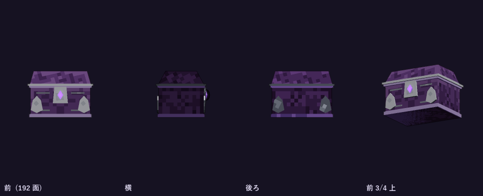 | 今の形 |
| 案 | 三角形 | 中身 |
| --- | --- | --- |
| **A 銀の葉冠** | 408 | 角の銀の葉を大きくし、ふたの上に銀の三日月の冠と五つの石、封の下に銀の鎖の垂れ |
| **B 紫紋の箱** | 392 | 縦の銀の帯三本と鋲。ふたの上に四つの紫の石を銀の線でつないだ紋、封は銀の環 |
| **C 二重のふた** | 392 | ふたを二段に積み、段の縁を銀の唐草がめぐる。角は銀の留め、封の左右に銀の小鈴 |

**A 銀の葉冠**

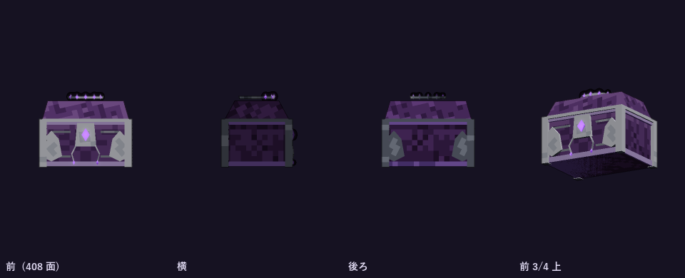

**B 紫紋の箱**

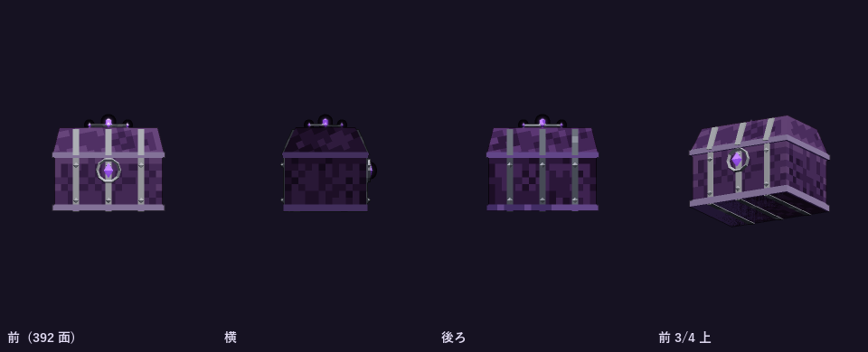

**C 二重のふた**

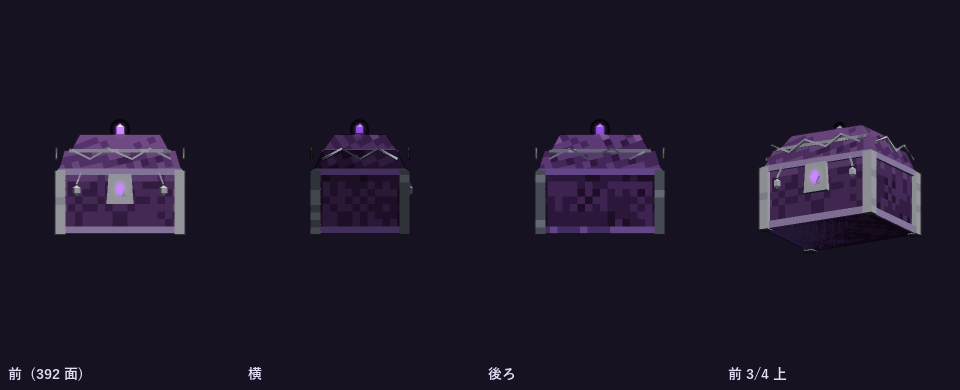

## 淵の金の箱 (アーティファクト)

今 248 三角形 (ヒロイック 664 より少ない)

| 今 | |
| --- | --- |
| 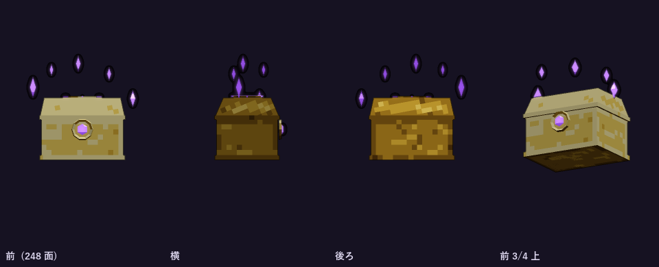 | 今の形 |
| 案 | 三角形 | 中身 |
| --- | --- | --- |
| **A 欠片の冠** | 432 | 角に金の柱と石、ふたの上の二重の金の輪から九つの淵の欠片が浮く |
| **B 金の格子** | 448 | ふたと側面に金の格子、交わりに淵の石。ふたの上に大きな金の輪と六つの欠片 |
| **C 淵の暈** | 452 | 箱のまわりを水平と斜めの二本の金の輪がめぐり、七つの欠片が輪に沿って浮く。角は金の棘 |

**A 欠片の冠**

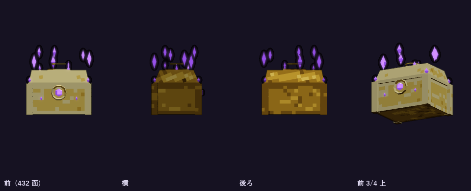

**B 金の格子**

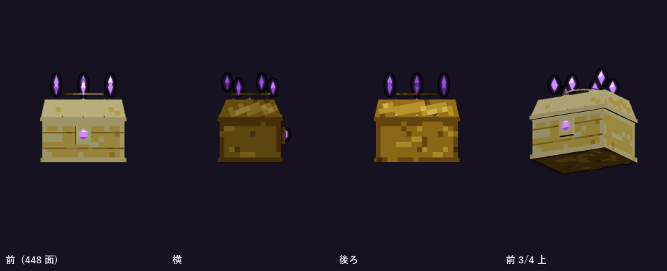

**C 淵の暈**

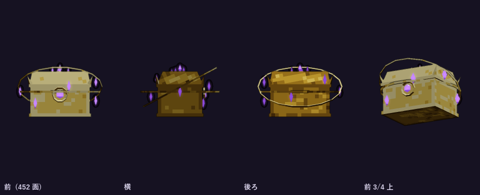

## 雲雀の羽根飾り (ヒロイックの装飾)

今 90 三角形・32px (全品でいちばん少ない)

| 今 | |
| --- | --- |
| 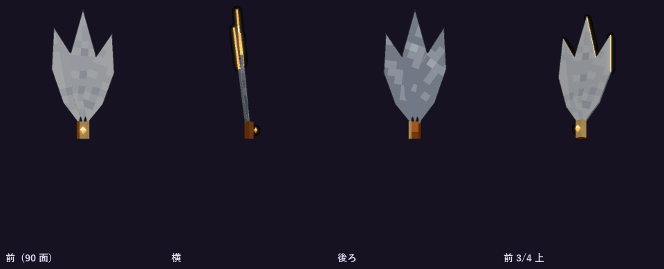 | 今の形 |
| 案 | 三角形 | 中身 |
| --- | --- | --- |
| **A 五枚の扇** | 268 | 羽根を五枚の扇に。金の留め具の輪に石、下に金の小鎖と雫 |
| **B 渦の留め具** | 260 | 大きな羽根三枚と小さな羽根二枚。金の渦の留め具に三つの石、二つの雫 |
| **C 巻く羽根** | 356 | 先が外へ巻く四枚の羽根、先に石。金の二重の輪のブローチと金の房 |

**A 五枚の扇**

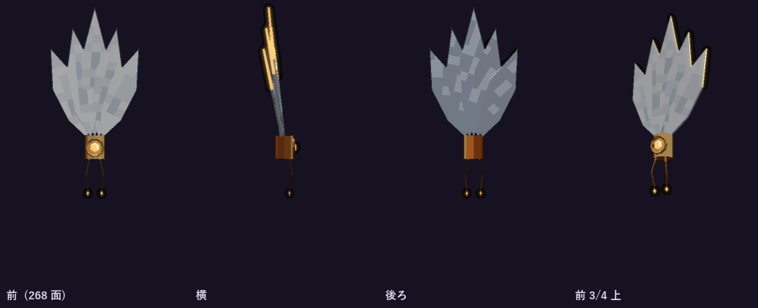

**B 渦の留め具**

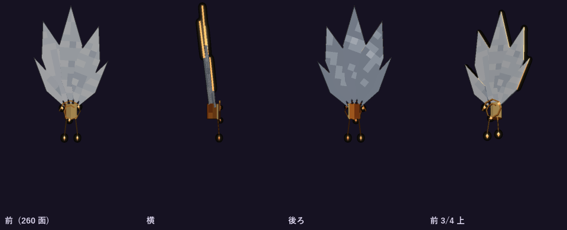

**C 巻く羽根**

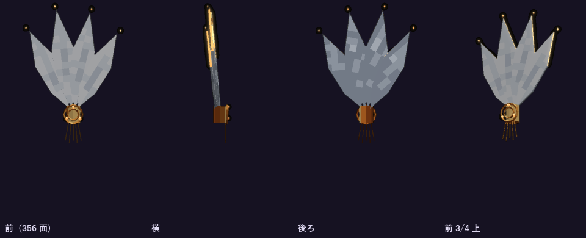
