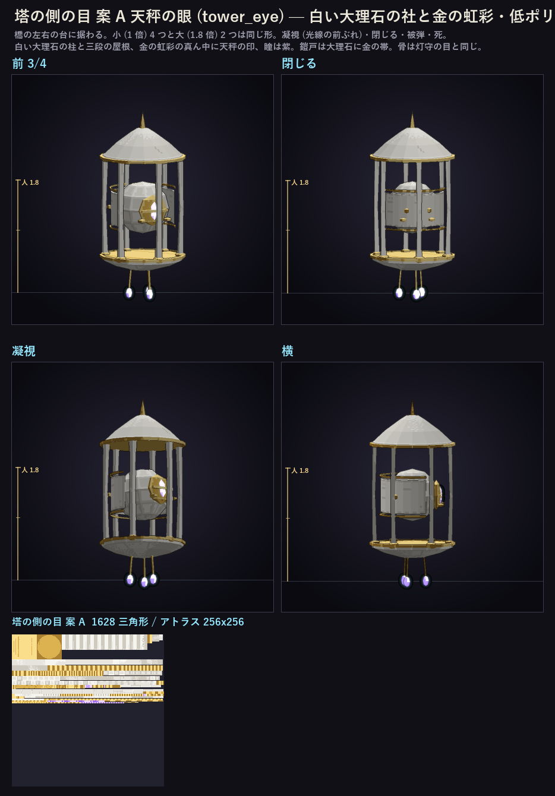
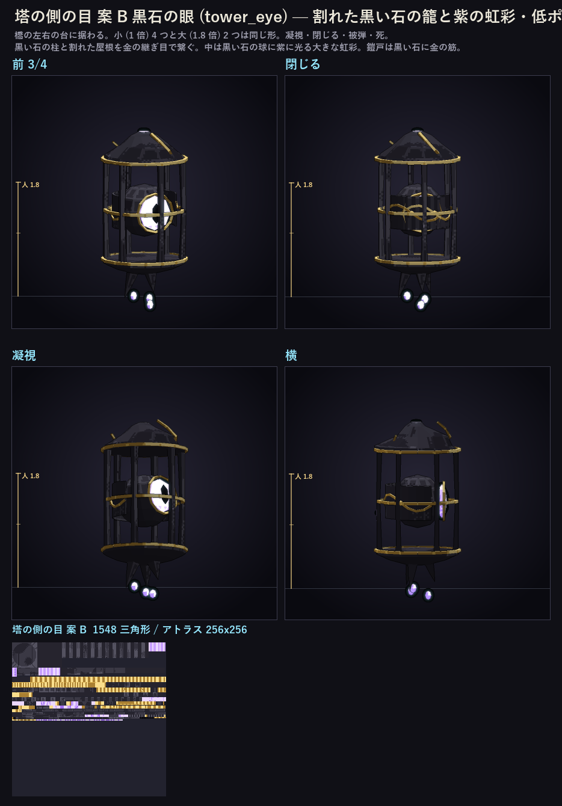
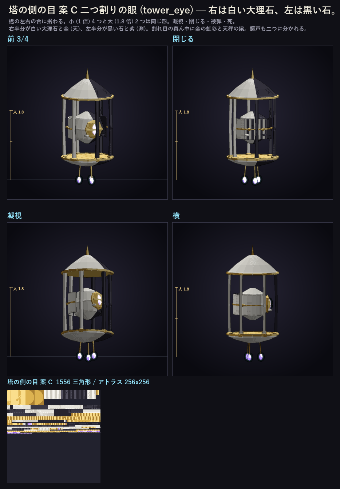
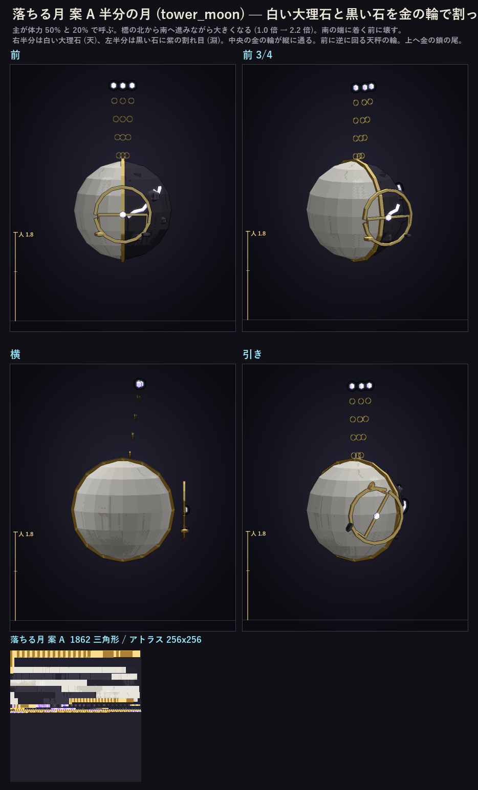
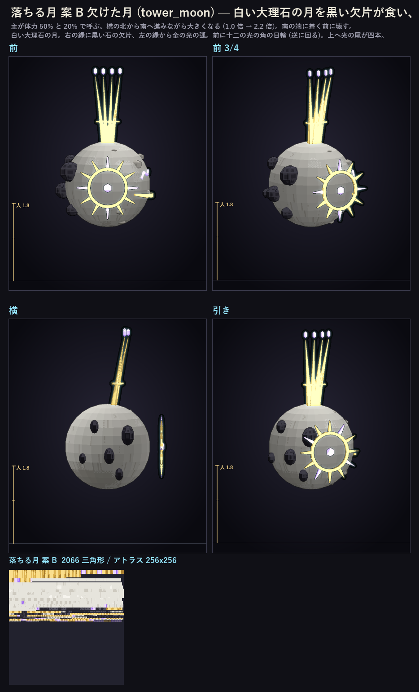
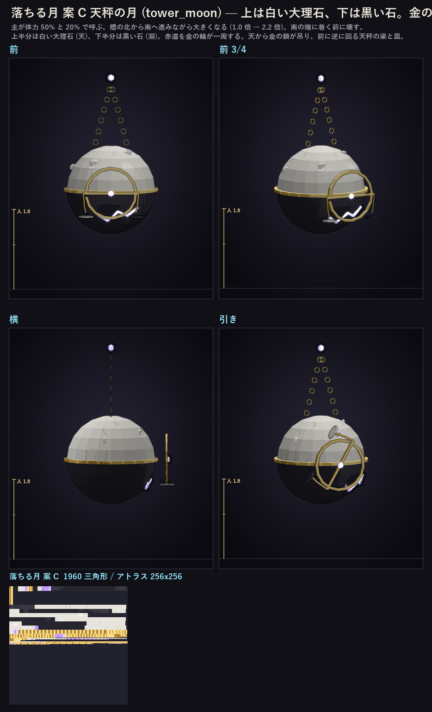

# 2026-11-02 あいだの塔の側の目と落ちる月のラフ（借り物をやめる）

あいだの塔の側の目 (`TowerEye`) と落ちる月 (`TowerMoon`) は、今は灯守の目 (`lamp_eye`) と巡礼者の月 (`pilgrim_moon`) の形を借りている。塔の主の作りに合わせて、それぞれ三案ずつ作った。一品一案なので、どちらも一つだけ選ぶ。案ごとに A だけを書き出してある（`tools/rough/lowpoly/cloud/tower_eye_{a,b,c}.py` と `tower_moon_{a,b,c}.py`）。

骨は借りていた形と同じ名前にしてある（側の目は `cage` / `eye` / `shutter_l` / `shutter_r`、落ちる月は `moon` / `chains` / `clock`）。だから `lamp_eye.animation.json` の stare・closed・rain・call・hurt・death と、`pilgrim_moon.animation.json` の pull・sweep・rewind・fall・call・hurt・death が、そのまま新しい形を動かせる。

三角形の数は水密にした後（採用時に `mesh_close` を通した後）の数。書き出し直後の数は括弧内。目安は側の目 1400〜1800、落ちる月 1800〜2400（灯守の目 1788、巡礼者の月 2292 と同じ数え方）。

**側の目と落ちる月は、小と大で同じ形を使う。** 側の目の小は 1.0 倍、大は 1.8 倍（`CloudMobRenderers` の拡大率）。

## 側の目 (tower_eye)

| 案 | 三角形 | 中身 |
| --- | --- | --- |
| **A 天秤の眼** | 1796 (1628) | 白い大理石の柱六本と三段の屋根、金の虹彩の真ん中に天秤の梁と皿、瞳は紫。鎧戸は大理石に金の帯。下に金の鎖と紫の玉 |
| **B 黒石の眼** | 1742 (1548) | 割れた黒い石の柱と屋根を金の継ぎ目で繋ぐ。中は黒い石の球に紫に光る大きな虹彩。鎧戸は黒い石に金の筋。下に紫の欠片 |
| **C 二つ割りの眼** | 1708 (1556) | 右は白い大理石と金、左は黒い石と紫。柱・屋根・鎧戸も右左で分け、割れ目の真ん中に金の虹彩と天秤の梁 |

**A 天秤の眼**

**B 黒石の眼**

**C 二つ割りの眼**

## 落ちる月 (tower_moon)

| 案 | 三角形 | 中身 |
| --- | --- | --- |
| **A 半分の月** | 2006 (1862) | 右半分は白い大理石、左半分は黒い石に紫の割れ目。中央を金の輪が縦に通る。前に逆に回る天秤の輪。上へ金の鎖の尾が三本 |
| **B 欠けた月** | 2248 (2066) | 白い大理石の月。右の縁を黒い石の欠片が食い、左の縁から金の光の弧。前に十二の光の角の日輪（逆に回る）。上へ光の尾が四本 |
| **C 天秤の月** | 2114 (1960) | 上は白い大理石、下は黒い石。赤道を金の輪が一周。天から金の鎖が吊る天秤（梁と二つの皿）が前で逆に回る |

**A 半分の月**

**B 欠けた月**

**C 天秤の月**

## 検査

- 六案とも、水密化の後に開いた辺・向きの食い違い・裏返った面・つぶれた三角形はゼロ（`tools/lib/mesh_close.py` の `close_mesh` と `tools/audit/mesh_audit.py` の解析で確かめた）。
- 埋まった部品の検査（`check_buried`）は六案とも指摘なし。
- 関節の隙間（`mesh_audit` の joint 検査）と、アニメ上の裏面の透けは、まだ見ていない。

## 採用（2026-11-02）: 側の目は C 二つ割りの眼、落ちる月は A 半分の月

入れた: `docs/review/cloud_roughs/tower_eye/a/`・`tower_moon/a/` に写し、`gen_cloud_mobs.py tower_eye tower_moon`。Java は `TowerEye.ID`・`TowerMoon.ID` を自前の形に向けた（`CloudMobRenderers`）。B と残りの案はこのページと `cloud_roughs/tower_*_{a,b,c}` に残す。

## 入れ方（記録）

入れるのは `tools/gen/finale/gen_cloud_mobs.py` で、`CHOICE` に書いた名前の順に `docs/review/cloud_roughs/<名前>/<案>/<名前>_<案>_*` を読み、`tools/install/install_lowpoly.py` で `assets/skyabyss/` に入れる。インストーラは書き出しの前に `mesh_close` を通す。この二体はまだ `CHOICE` にも `ANIMS` にもないので、次の順で足す。

1. 採用する案の名前を決める（例: `tower_eye_c`）。
2. `docs/review/cloud_roughs/tower_eye/a/` に、採用案のファイルを `tower_eye_a_mesh.json` `tower_eye_a_atlas.png` `tower_eye_a_glowmask.png` の名前で写す（`tower_moon` も同じ）。
3. `gen_cloud_mobs.py` の `CHOICE` に `"tower_eye": "a"`、`"tower_moon": "a"` を足し、`ANIMS` に `"tower_eye": lamp_eye`、`"tower_moon": pilgrim_moon` を足す（骨名が同じなのでアニメ関数はそのまま流用できる）。
4. 実行: `PYTHONIOENCODING=utf-8 python -X utf8 tools/gen/finale/gen_cloud_mobs.py tower_eye tower_moon`（名前を並べるとその敵だけ入る）。
5. Java 側: `TowerEye` は `LampEye.ID`、`TowerMoon` は `PilgrimMoon.ID` を使っているので、新しい ID（`tower_eye` / `tower_moon`）に向けるには、`CloudMobsSetup` と `CloudMobRenderers` の登録も新しい ID に変える必要がある。この作業はまだしていない（ラフ作業の範囲外）。

ラフの生成: `python -I tools/rough/lowpoly/cloud/tower_eye_a.py` など（出力は `docs/review/cloud_roughs/tower_eye_a/` と `tower_eye_a.png`）。この作業では何も入れていない（`src/main/resources` は触っていない）。
