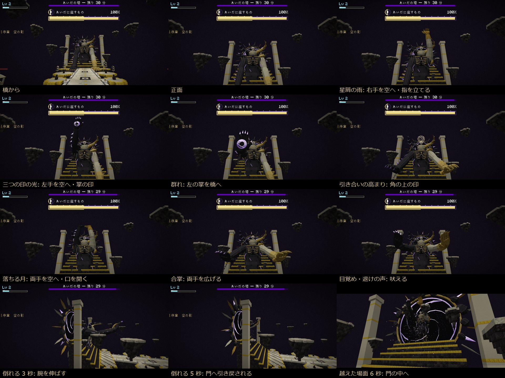
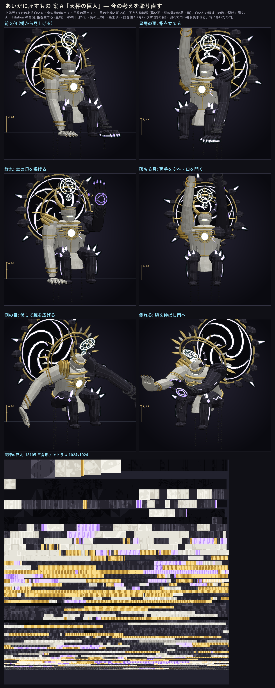
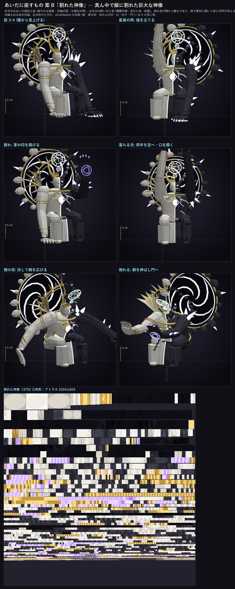
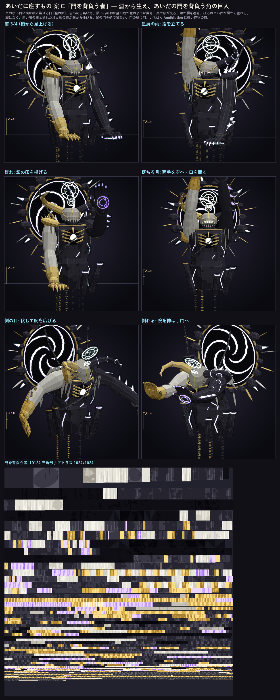

# 2026-11-02 あいだに座すもの（塔の主）の作り直し 3 案

**選んだ: C 門を背負う者**（2026-11-02。入れた。合図の動きと確かめは [54 の 2.2](../../design/54_endgame_plan.md)・撮影 `tools/shots/tower_master_cues.txt`）

声（2026-11-02）「ボスのもっとモデルやアニメーション、攻撃表現もっと凝っていい」「もっとレイドの形自体 Wynncraft のアンニアレーションみたいに」。

今の形（9680 三角形）は筒と楕円体を重ねただけで、技の合図を持たない。Wynncraft の Annihilation は、技ごとに手と顔で合図する（wiki: 星屑の前に人さし指を立てる、群れの前に掌の印を掲げる、高まりで角の上に印、月を呼ぶときに両手を上げて口を開く、側の目の前に伏して腕を門の左右へ広げる、倒れると腕を伸ばしたまま門へ引き戻される）。三案とも、その合図のための骨を持つ。

**共通（三案とも同じ）**

- 骨 19 本: 前の 12 本に、`index_r`（右の人さし指）・`fingers_r`（右のほかの指を握る）・`palm_l`（左の掌の印）・`sigil`（角の上の印）・`jaw`（口）・`rift`（背のあいだの門）を足した。
- 両手の置き場（橋の北の広場）と、顔・胸の高さは今と同じ。舞台はそのまま使える。
- 背に「あいだの門」（黒い石の欠片の輪・金の縁・紫の渦）。倒れると、主は腕を伸ばしたまま門へ引き戻され、門が閉じる（Annihilation の終わり方）。
- 掌の印と角の上の印は、ふだん大きさ 0。技のときだけ開く。

三角形の数は書き出した直後の数（採用時に水密にすると 1 割ほど増える）。生成は `tools/rough/lowpoly/cloud/tower_master_{a,b,c}.py`（共通の部品 `tower_master_kit.py`）。

| 案 | 三角形 | 中身 |
| --- | --- | --- |
| **A 天秤の巨人** | 18105 | 今の考えのまま彫り直す。ひだの白い衣、金の肋の胸当て、三枚重ねの肩当て（右 金・左 黒い石）、二重の光輪と羽 24 枚。白い布の顔は口の所で裂けて開く（中に朝の光）。節のある角。膝から紫の結晶、腰から淵へ鎖 |
| **B 割れた神像** | 13752 | 座った神像が真ん中で縦に割れる。右半分は大理石と金（穏やかな仮面・日輪の冠・大理石の翼）、左半分は黒い石と紫（髑髏の顔・折れた角・結晶）。割れ目が顔から腰まで光り、胸で菱形に開いて核と天秤が見える。光輪も右は日輪、左は砕けた欠片 |
| **C 門を背負う者** | 18924 | 角と口の怪物。目のない白い面に縦に裂ける口（金の歯）、横へ張って前へ反る長い角。黒い石の胸に金の肋が籠のように開き、奥で核が光る。鎖が胴を巻き、ぼろの白い衣。脚はなく、淵から黒い石の根と折れた柱と鎖。背の門を鎖で背負う |

**A 天秤の巨人**

**B 割れた神像**

**C 門を背負う者**

## 選んだあとに作るもの

- 形: 選んだ案を彫り込む（胴の形・指の節・衣のひだ）。水密にして入れる（`gen_cloud_mobs.py tower_master`）。
- 動き: 技ごとの合図（上の六つの姿）を動きにする。今の 12 の動きは、合図を足して作り直す。
- 技の見え方と、倒したあとの場面: 下の「塔の戦いの作り直し」（形が決まる前に作れるものは先に入れる）。

## 検査

- 埋まった部品（`check_buried`）: A は肩当ての重なりと腿の割れ目（5 割前後）、B は前の布の裾と口の光、C はぼろの衣の付け根と下の歯。どれも表面に刺さる程度で、採用時に直す。
- 開いた辺・裏返りは、採用して水密にしたあとに `mesh_audit` で見る。
