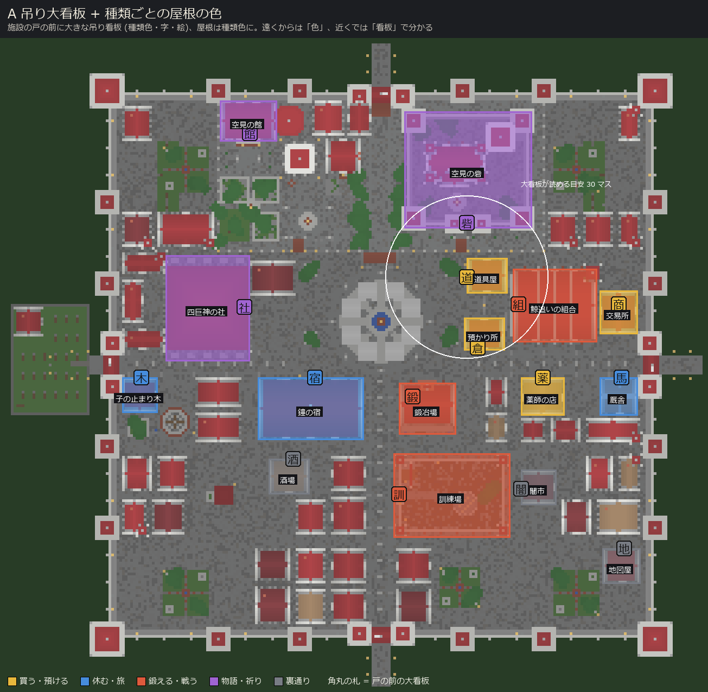
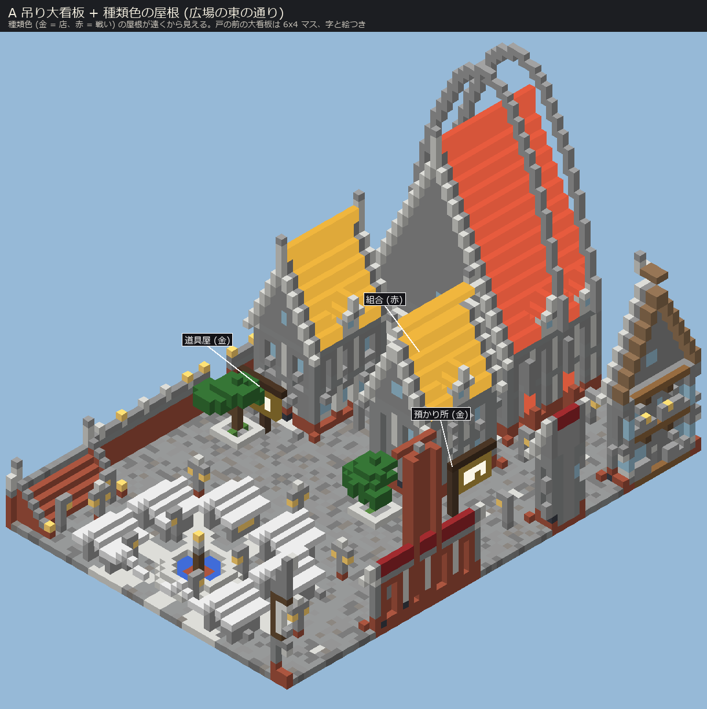
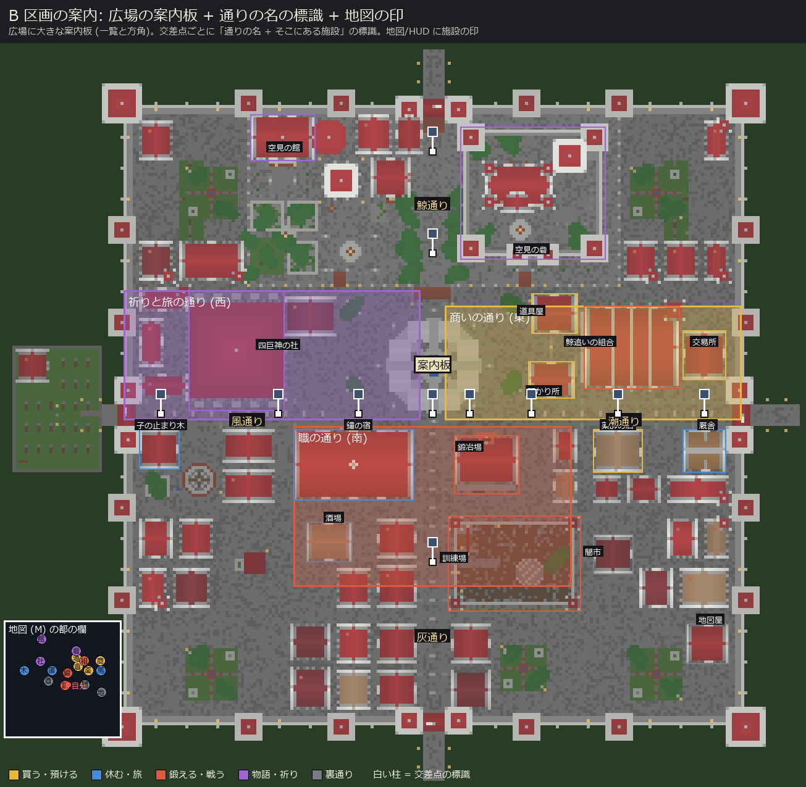
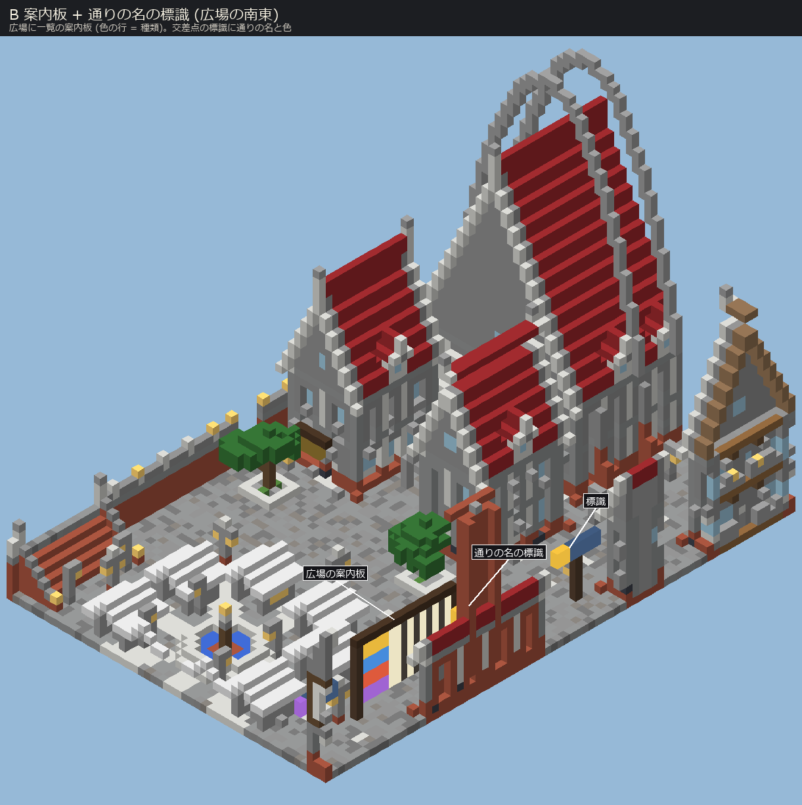
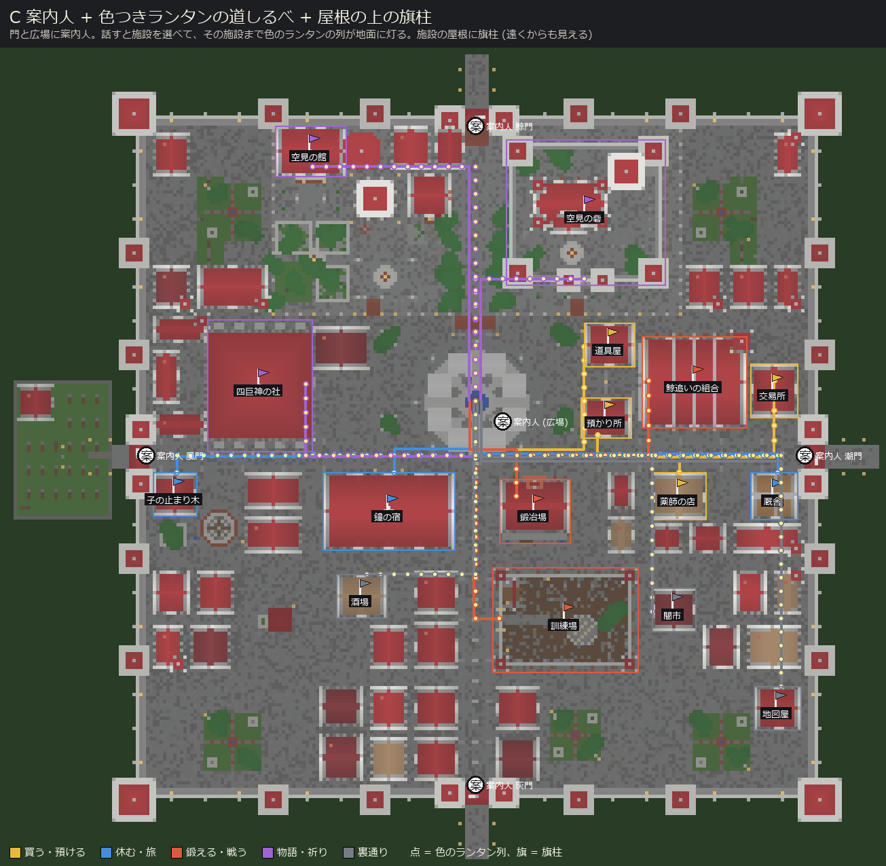
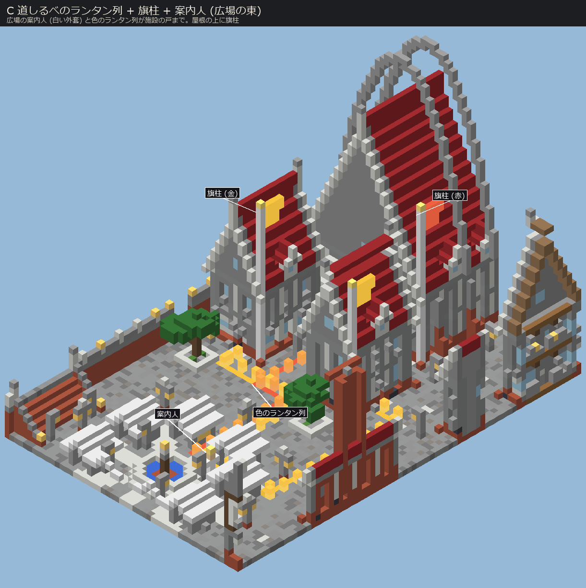

# 都の施設を見つけやすくする案 (提案のみ・未実装)

2026-10-23 の試遊「村の施設の場所がまだ分かりにくい」への 3 案。どれもゲームの挙動はまだ変えていない (capital.json も同じ)。
絵は `python -I tools/capital/town_finding_roughs.py` で作る (本物の capital.json の上面図と、Town の足もとに提案を重ねたもの)。
通りの絵は広場の東 (道具屋・預かり所・組合) を南西の空から見た等角図で、提案の物だけを足している。

今ある手がかり: 戸の上に浮く名 (`label_<施設>`、ShelterBuilder.placeLabel)、石碑 `sign_*`、壁の吊り看板 (vox.hanging_sign)、
目的地の矢印/道しるべ (client/guide: GuideArrow, GuideTrailRenderer, ObjectiveMarker)、地図 (client/map: TravelMapScreen)。
どれも小さい・近づかないと読めない・全部同じ色、というのが分かりにくさの原因。

色の分け (3 案共通): 金 = 買う・預ける (道具屋・預かり所・交易所・薬師)、青 = 休む・旅 (宿・厩舎・止まり木)、赤 = 鍛える・戦う (組合・鍛冶場・訓練場)、紫 = 物語・祈り (社・砦・館)、灰 = 裏通り。

## A 吊り大看板 + 種類ごとの屋根の色

 

- 見え方: 道を歩くと、店の屋根が種類の色 (金・青・赤・紫) で遠くから分かる。戸の前には 6x4 マスの大きな腕木看板 (種類の色の板に絵と字)。
- 良い点: 歩きながら一目で分かる。操作も UI も要らない。今の見た目の方向 (緋の屋根) と近く、街並みの統一感は少し落ちる程度。
- 悪い点: 屋根の色を変えるので街の見た目が変わる (金・青の屋根が増える)。看板は 30 マスほどまで近づかないと読めない。種類が 5 つ以上に増えると色が足りない。
- 手間: 中。town.py/facilities.py の屋根の材料を種類で変える + 大看板の部品 (vox.py に big_sign) を足す。capital.json が変わり、再生成 + audit が要る。
- 触るファイル: tools/capital/vox.py (big_sign)、facilities.py (各施設の屋根・看板の呼び出し)、town.py、capital.json。ゲームの Java は不要 (石碑の絵が要るなら block 追加)。

## B 区画の案内: 広場の案内板 + 通りの名の標識 + 地図の印

 

- 見え方: 広場に大きな案内板 (種類の色の行に「施設名 + 方角」)。大通りの交差点ごとに「通りの名 (潮通り・風通り・鯨通り・灰通り) + その先の施設」の標識。東 = 商いの通り、西 = 祈りと旅、南 = 職の通り、と地区の名を付ける。地図 (M) と HUD には施設の印 (字つき、種類の色)。
- 良い点: ゲームで言う「迷わない町」の定番。初見でも「どの通りに何がある」を言葉で覚えられる。地図の印は都の外から来た人にも効く。
- 悪い点: 読む必要がある (子ども向きではない)。標識は小さく、通りの名を覚える手間がある。区画の名づけで docs/design 33 の世界観に合わせる必要。
- 手間: 中〜大。標識と案内板は town.py (石碑 tablet の使い回し + 文字は TextDisplay か看板)、地図の印は TravelMapScreen と MapClient に施設の印の一覧 (capital の marks から label_* を引く) を足す。HUD の小さい方角表示は VitalsHud 付近。
- 触るファイル: tools/capital/town.py (案内板・標識)、capital.json、client/map/TravelMapScreen.java + MapClient.java、(任意) client/hud/。

## C 案内人 + 色つきランタンの道しるべ + 屋根の上の旗柱

 

- 見え方: 門と広場に「案内人」(白い外套)。話すと施設の一覧が出て、選ぶとその施設の戸まで色つきのランタンが地面に灯る (今の目的地の矢印・道しるべ GuideTrailRenderer の延長)。各施設の屋根には高い旗柱が立ち、街のどこからでも「あそこに店がある」と分かる (旗の色 = 種類)。
- 良い点: 一番分かりやすい。読まなくても付いていけば着く。旗柱は遠くから見えるので、広い都でも位置関係が分かる。道しるべは物語の目的地の矢印の仕組みを使い回せる。
- 悪い点: 案内人に話しかける一手間がある (旗柱だけなら無い)。ランタンの列は建物の間が込み合って見える。サーバー側で道を覚えさせる (または経路探索) ため、他の 2 案より仕組みが多い。
- 手間: 大。案内人 (npc/ に係の人と同じ作り) + 施設一覧 UI (FacilityUi の流用) + 経路の計算 (大通りの芯までの直角経路で足りる) + 道の描画 (GuideTrailRenderer 拡張)。旗柱だけなら town.py の建物に高い柱を足すだけ (小)。
- 触るファイル: client/guide/*、client/facility/FacilityUi.java、npc/ (案内人)、facility/Attendants.java、tools/capital/town.py (旗柱・案内人の印 npc_guide_*)、capital.json。

## 組み合わせの勧め

手間が小さい順に A の屋根の色 (A の看板は後) → C の旗柱だけ → B の地図の印、で段階的に入れられる。
全部は多すぎるので、まず A (屋根の色 + 大看板) と B の地図の印、それでも足りなければ C の案内人、が無難。
